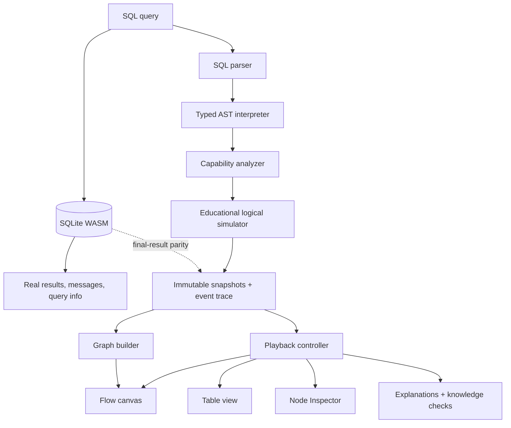

<h1 align="center">
  <br />
  SQL Visualizer
</h1>

<p align="center">
  <b>See what your SQL actually does.</b><br />
  A browser-based SQL playground that runs real SQLite locally and replays supported
  <code>SELECT</code> queries as an animated, inspectable data-flow graph.
</p>

<p align="center">
  
  
</p>

<p align="center">
  <a href="#overview">Overview</a> ·
  <a href="#key-features">Features</a> ·
  <a href="#screenshots">Screenshots</a> ·
  <a href="#how-it-works">How it works</a> ·
  <a href="#installation-and-setup">Quick start</a> ·
  <a href="#documentation">Documentation</a> ·
  <a href="#roadmap">Roadmap</a>
</p>

<p align="center">
  <a href="#installation-and-setup"><b>Run it locally →</b></a> &nbsp;·&nbsp;
  <a href="docs/ARCHITECTURE.md">Read the architecture</a>
</p>

<p align="center">
  
</p>

<p align="center">
  <sub>The Query workspace: database explorer, Monaco editor, saved queries, history and real SQLite results.</sub>
</p>

---

## Overview

SQL Visualizer is a working SQL workspace with an educational execution model layered on top. You
write SQL, run it against a real SQLite database compiled to WebAssembly, and then switch to a
Blender-inspired canvas to watch a supported `SELECT` flow through logical stages.

There is no backend, no account and no telemetry. Database files, history and saved queries stay in
the browser's IndexedDB.

| 🎬 Learn by seeing | 🔒 Local by design | ✅ Real results first |
|:---|:---|:---|
| Every stage becomes a node you can step through, with real row counts and inspectable snapshots — including the rows a filter rejects. | SQLite runs as WebAssembly inside the tab. No backend, no account, and no query data leaves your machine. | SQLite executes the query for real. The visual simulator checks its final result against SQLite's output instead of inventing one. |

The visual model is deliberately honest: it is an **educational logical pipeline**, not SQLite's
physical query plan. When a construct cannot be modeled faithfully, the app explains why rather than
guessing.

## Key features

### SQL workspace

| Feature | What it does |
|:---|:---|
| **Real SQLite execution** | Queries execute against SQLite compiled to WebAssembly. Results are not mocked. |
| **Monaco SQL editor** | Syntax highlighting, schema-aware autocomplete and `Ctrl/Cmd + Enter` to run. |
| **Results, messages and query info** | Tabbed output with display types, row counts, execution time, statement breakdown and error messages. |
| **Multiple statements** | Run scripts separated by semicolons; results and messages report per-statement outcomes. |
| **Saved queries and history** | Named queries and an execution log persist across refreshes; history can be filtered by database. |
| **Query / Canvas toggle** | Query is the startup default, including after reload. Both workspaces stay mounted, so editor state, results, zoom, selection and playback survive the switch. `Ctrl/Cmd + Shift + M`. |

### Database workspace

| Feature | What it does |
|:---|:---|
| **Multiple independent databases** | Each database has its own SQLite file and schema; history and saved queries are tagged to it. |
| **Templates and custom SQL** | Start blank, load the University example, or create a database from your own setup script. |
| **Import and export** | Import `.db`, `.sqlite`, `.sqlite3` or `.sql`; export as `.sqlite` or as a SQL script. |
| **Rename, duplicate, reset and delete** | Manage database records without leaving the app. Resetting a template database replays its setup state. |
| **Persistent and local** | Database bytes, metadata, history and saved queries live in IndexedDB. |
| **Schema explorer** | Browse tables, columns, keys and indexes, and open the original `CREATE TABLE` statement. |

### Visualization and inspection

| Feature | What it does |
|:---|:---|
| **Animated logical pipeline** | Renders the supported query pipeline as connected nodes: sources, joins, filters, grouping, projection and the final result. The default animation covers the full pipeline; hover or selection narrows the highlighted upstream path. |
| **Nested query blocks** | Scalar subqueries, uncorrelated `IN` / `EXISTS` subqueries and non-recursive CTEs run as their own real pipelines, with dependency edges into the stage that consumes them and block-specific playback. Every `UNION` / `UNION ALL` / `INTERSECT` / `EXCEPT` branch is likewise an independent block feeding the actual left-to-right compound operation sequence. |
| **Stage snapshots and playback** | Snapshots carry real rows through every stage. Play, pause, step, seek, restart or jump to the end, at 0.5×, 1×, 1.5× or 2× speed. |
| **Flow and Table views** | Switch between the node canvas and a row-level table for the current stage, including accepted, filtered, duplicated, grouped or skipped rows. |
| **Branch-aware tracing** | Hover a node to temporarily animate its upstream path; click to pin the selection and open the inspector. Rejected rows branch visibly at filters and `HAVING`. |
| **Floating Node Inspector** | Click a node to open a draggable, resizable window with Overview, Input, Output and Details tabs, real row previews and node-specific information. Collapse it to a header-only strip or minimize it to a dock chip, then restore the same window. |
| **Synchronized explanations** | A documentation sidebar follows the active stage with beginner/intermediate/advanced explanations, real counts, SQLite references and optional knowledge checks. |

## Screenshots

<p align="center">
  
</p>

<p align="center">
  <sub><b>Playback</b> — a real <code>SELECT</code> moving through FROM → JOIN → WHERE → SELECT. Rejected rows branch off at the filter.</sub>
</p>

<table>
  <tr>
    <td width="50%" align="center" valign="top">
      
      <br />
      <sub><b>Flow canvas</b> — source tables, operations, intermediate results and a final result node.</sub>
    </td>
    <td width="50%" align="center" valign="top">
      
      <br />
      <sub><b>Table view</b> — the same playback, focused on row-level transformations.</sub>
    </td>
  </tr>
  <tr>
    <td width="50%" align="center" valign="top">
      
      <br />
      <sub><b>Database manager</b> — create, rename, duplicate, reset, import and export independent databases.</sub>
    </td>
    <td width="50%" align="center" valign="top">
      
      <br />
      <sub><b>Schema viewer</b> — columns, keys and the original DDL for every table.</sub>
    </td>
  </tr>
</table>

## Technology

| Layer | Stack |
|:---|:---|
| **Frontend** | React 19.3 · TypeScript 7.0 · Vite 8.3 · Tailwind CSS 4.3 |
| **SQL engine** | SQLite via sql.js 1.16 (WebAssembly) · node-sql-parser 5.4 · Monaco Editor 0.57 with `@monaco-editor/react` 4.7 |
| **State and persistence** | Zustand 5.1 · idb 8.0 (IndexedDB) |
| **Visualization** | Custom SVG/DOM flow canvas · Motion 14.12 · Lucide React 1.72 |
| **Testing and tooling** | Vitest 5.1 · Testing Library 16.3 · jsdom 31.0 · oxlint 1.90 |

## How it works



SQLite is always the source of truth. The simulator applies logical stages to real table data,
records immutable snapshots, and validates its final result against SQLite — ordered when
`ORDER BY` fully determines the order, unordered otherwise. If a construct cannot be modeled
faithfully, visualization stops with explicit reasons.

## SQL visualization pipeline

| Stage | What it shows |
|:---|:---|
| `FROM` | Source rows read from the live database. |
| `JOIN` | Matched rows from INNER, LEFT and CROSS joins. |
| `WHERE` | Rows accepted or rejected by the filter predicate. |
| `GROUP BY` | Rows collected into groups. |
| `HAVING` | Groups accepted or rejected by the group predicate. |
| `SELECT` | Projected columns and computed values. |
| `DISTINCT` | Duplicate projected rows removed. |
| `COMPOUND` | Independent `SELECT` branches combined left-to-right with `UNION`, `UNION ALL`, `INTERSECT` or `EXCEPT`; distinct set semantics remove duplicates with NULL-safe whole-row comparison. |
| `ORDER BY` | Rows sorted by the requested keys. |
| `LIMIT` / `OFFSET` | Rows kept or skipped at the end of the pipeline. |
| Nested query block | A non-correlated scalar subquery, `IN` / `NOT IN` subquery, `EXISTS` / `NOT EXISTS` subquery, non-recursive CTE, or one `SELECT` branch of a compound query, simulated as its own real pipeline and wired into the stage that consumes it. Compound operations expose their accumulated left input, next right input, retained rows, excluded rows and duplicates. |

<details>
<summary><b>Scope and honest limits</b></summary>

- Visualization is for **supported `SELECT` statements**, including `UNION`, `UNION ALL`, `INTERSECT` and `EXCEPT` compounds. DDL and DML still execute normally in SQLite, but are not visualized.
- Supported joins: INNER, LEFT and CROSS. Comma cross joins are not supported.
- Supported expressions include comparisons, `AND`/`OR`/`NOT`, `IN`, `BETWEEN`, `IS NULL`, `LIKE`, arithmetic and `COUNT`/`SUM`/`AVG`/`MIN`/`MAX`.
- **Non-correlated scalar subqueries** are supported in `WHERE`, `SELECT` and `JOIN … ON`, following SQLite's rules: an empty result becomes `NULL`, multiple rows use the first row, and the subquery must return one column.
- **Uncorrelated `IN` / `NOT IN` subqueries** are supported with SQLite three-valued logic: an empty result is `false` (`true` for `NOT IN`), a `NULL` outer value is unknown, a `NULL` member makes `NOT IN` unknown, and the subquery must return exactly one column.
- **Uncorrelated `EXISTS` / `NOT EXISTS`** are supported; the subquery's column count is irrelevant and only row presence affects the result.
- **Non-recursive CTEs** (`WITH`) are supported: multiple definitions, chained dependencies, explicit column lists, and supported scalar / `IN` / `EXISTS` subqueries inside a CTE body.
- **`UNION`, `UNION ALL`, `INTERSECT` and `EXCEPT`** compound selects are supported. Each `SELECT` branch is simulated independently, then operators fold strictly left-to-right: `A UNION B INTERSECT C` means `(A UNION B) INTERSECT C`, not `A UNION (B INTERSECT C)`. `UNION` removes duplicates across the accumulated result, `UNION ALL` preserves them until a later distinct operator, `INTERSECT` keeps distinct rows present in both inputs, and `EXCEPT` keeps distinct left rows absent from the right. Comparisons use complete rows with NULL-safe keys, so corresponding NULLs compare equal. Branches must return matching column counts, and the first branch names the output columns. Root `ORDER BY` and `LIMIT` / `OFFSET` apply after the complete chain. Each operation exposes its accumulated left input, next right input, retained rows, excluded rows and duplicates in the canvas, playback and inspector. Table View shows the final compound result and first-branch column names.
- Not yet visualizable: **correlated** subqueries (including correlated `IN` / `EXISTS`), recursive CTEs (`WITH RECURSIVE`), nested compound forms not covered by the existing nested-block interpreter, derived tables in `FROM`, `RIGHT`/`FULL OUTER JOIN`, window functions, `CASE`, and other constructs the parser cannot model conservatively. `INTERSECT ALL`, `EXCEPT ALL`, `UNION DISTINCT` and `INTERSECT DISTINCT` are rejected explicitly rather than approximated.
- The current `node-sql-parser` grammar does not parse every compound form. A quote/comment/parenthesis-aware splitter preserves branch SQL and root clauses as a safe fallback for `INTERSECT`, `EXCEPT` and mixed chains; unsupported or malformed forms return explicit reasons.
- Large inputs are capped for visualization (500 rows, 2,000 events). The real SQLite result remains complete and is never truncated.

See [docs/FEATURES.md](docs/FEATURES.md) for the full capability and limitation matrix.

</details>

### What a query becomes

```sql
SELECT d.department_name,
       COUNT(*)      AS employees,
       SUM(e.salary) AS payroll
FROM employees AS e
JOIN departments AS d ON d.id = e.department_id
WHERE e.salary > 30000
GROUP BY d.department_name
HAVING COUNT(*) >= 2
ORDER BY payroll DESC;
```

SQLite returns three rows from the University example:

| department_name | employees | payroll |
|:---|---:|---:|
| Marketing | 3 | 152000 |
| Engineering | 2 | 135000 |
| HR | 2 | 110000 |

Press **Visualize** and the same query unfolds as:

`FROM employees` → `JOIN departments` → `WHERE salary > 30000` → `GROUP BY department_name` → `HAVING COUNT(*) >= 2` → `SELECT` → `ORDER BY payroll DESC`

Each node carries real row counts; filtered rows branch off at the WHERE gate, grouping collects rows
into visible groups, and the final node shows the projected result. Because `ORDER BY` fully
determines the order, the workspace reports **Validated (ordered) vs SQLite**.

## Database management

Databases are first-class records, not tabs on a single global file:

- **Create** from a blank schema, the University example, or your own setup SQL.
- **Switch** between databases; the active database is remembered across reloads.
- **Rename** metadata or **duplicate** the complete database bytes.
- **Reset** a template database to its setup state, or clear an imported database to empty.
- **Export** as a `.sqlite` file or as a re-creatable SQL script.
- **Import** an existing SQLite file or SQL script as a new database.
- **Inspect** tables, row counts, keys, indexes and original DDL in the schema explorer.

A visualization trace belongs to the database it was built from. Switching databases invalidates the
trace rather than showing data from the wrong workspace.

## Node Inspector and canvas interactions

- **Pan and zoom** by dragging empty canvas space and scrolling; use fit-to-screen and reset controls.
- **Drag nodes** to reposition them; collisions settle locally without changing the query.
- **Hover** a node to animate its branch-aware upstream path without changing the pinned selection.
- **Click** a node to pin that trace and open the floating inspector.
- **Inspect** real input and output rows, group keys, join details, accepted/rejected counts and
  final-result rows. The Overview, Input, Output and Details tabs are node-specific.
- **Move and resize** the inspector with its header and eight resize handles. Position and size are
  owned by the workspace, so they survive switching nodes and playback updates.
- **Collapse** the window to its real 52px header strip. The collapsed window has no hidden expanded
  area, drags by its header, and uses the header height for workspace clamping; expanding restores the
  saved width, height and active tab.
- **Minimize** to a dock chip and restore the same window, or close it entirely.
- **Synchronize** with playback: the inspector follows the selected node's current status and never
  reveals final rows before playback produces them.

## Learning and guided exercises

The documentation sidebar is independently toggleable. It keeps its scroll position, learning level
and knowledge-check answer while closed, becomes an edge tab when dismissed, and overlays the canvas
on narrow layouts.

- **Learning levels:** beginner, intermediate and advanced explanations.
- **What happened:** the active stage's explanation uses the real snapshot counts.
- **Knowledge checks:** multiple-choice checks for selected stages at beginner and intermediate levels.
- **References:** curated SQLite documentation links per stage.

**Guided exercises are not implemented yet.** The knowledge checks are the current learning
interaction; a fuller exercise flow remains on the roadmap.

## Installation and setup

**Requirements:** Node.js `^20.19.0` or `>=22.12.0` (required by Vite 8), npm, and a modern browser
with WebAssembly and IndexedDB.

```bash
git clone https://github.com/Student-Abhishekkumar/SQL-Visualizer.git
cd SQL-Visualizer
npm install
npm run dev
```

Open <http://localhost:5173>. The University example database is created on first launch.

## Development commands

| Command | What it does |
|:---|:---|
| `npm run dev` | Start the Vite development server with HMR. |
| `npm run build` | Type-check and build production assets to `dist/`. |
| `npm run preview` | Serve the production build locally. |
| `npm test` | Run the full Vitest suite (40 files, 623 tests). |
| `npm run test:watch` | Run Vitest in watch mode. |
| `npm run lint` | Lint the project with oxlint. |
| `npm run typecheck` | Run the TypeScript project build without emitting. |

## Project structure

```text
src/
├─ app/                   App shell, theme provider, Monaco setup, dev bridge
├─ components/
│  ├─ editor/             Monaco SQL editor, toolbar, example queries
│  ├─ database/           Explorer, manager, schema viewer, database selector
│  ├─ history/            Query history and saved queries
│  ├─ results/            Results table, messages, query information
│  ├─ visualization/      Workspace, flow canvas, playback, table view, inspector, docs sidebar
│  ├─ layout/             Navbar, sidebar, workspace toggle, settings
│  └─ common/             Shared buttons, modal, tabs, tooltip
├─ services/
│  ├─ database/           SQLite WASM engine, multi-database manager, templates, seed data
│  ├─ sql/                Parsing and SQL formatting
│  ├─ visualization/      Interpreter, analyzer, simulator, validation, graph layout, explanations
│  └─ persistence/        IndexedDB persistence and migration
├─ store/                 Zustand stores for database, editor, history, UI and playback
├─ types/                 Shared TypeScript contracts
└─ test/                  Test setup helpers
docs/                     Architecture, feature reference, development guide and assets
public/                   Static assets
```

Only the directories that matter for orientation are shown; component-level tests live next to
their implementation.

## Current limitations

- **Client-only by design.** There is no account system, cloud sync or server-side database. Data
  lives in the current browser profile.
- **Storage is browser-managed.** Clearing site data removes databases, history and saved queries.
  Private browsing modes may reject IndexedDB writes.
- **Single user.** Concurrent editing from multiple tabs is not coordinated.
- **`SELECT` visualization.** Supported `SELECT` statements, including `UNION`, `UNION ALL`, `INTERSECT` and `EXCEPT` compounds, can be visualized. DDL, DML, transactions and other statements execute in SQLite but cannot be visualized.
- **Unsupported SELECT constructs.** Correlated subqueries (including correlated `IN` / `EXISTS`),
  recursive CTEs (`WITH RECURSIVE`), nested compound forms not covered by the existing nested-block
  interpreter, derived tables, `RIGHT`/`FULL OUTER JOIN`, `CASE`, window functions and non-constant
  `LIMIT`/`OFFSET` are reported instead of approximated. `INTERSECT ALL`, `EXCEPT ALL`, `UNION DISTINCT`
  and `INTERSECT DISTINCT` are also rejected explicitly.
- **Simulation caps.** Visualization is capped at 500 rows and 2,000 events; source previews show up
  to 12 rows. Real SQLite output is never truncated.
- **Educational model, not a query planner.** The simulator models logical stages only; it does not
  expose SQLite's physical plan, indexes or bytecode.
- **No sharing or capture.** There is no share link, image export or recording export.
- **No hosted demo.** Run the project locally with `npm run dev`.
- **No guided exercises yet.** Knowledge checks and stage explanations are available; full exercises
  are planned.

## Roadmap

The roadmap is directional, not a release commitment.

### ✅ Shipped

- [x] Real SQLite execution in the browser via WebAssembly
- [x] Monaco SQL editor with results, messages and query information
- [x] Multiple independent databases with templates, custom SQL, import/export and IndexedDB persistence
- [x] Animated logical pipeline with stage snapshots, playback and speed control
- [x] Flow and Table views with branch-aware hover and click tracing
- [x] Floating draggable/resizable Node Inspector with header-only collapse and minimize/restore
- [x] Toggleable documentation sidebar with synchronized explanations and knowledge checks
- [x] Non-correlated scalar subqueries simulated as nested pipelines
- [x] Non-recursive CTEs (multiple, chained, explicit columns) with query-block playback and dependency tracing
- [x] Uncorrelated `IN` / `NOT IN` and `EXISTS` / `NOT EXISTS` subqueries with SQLite three-valued logic
- [x] `UNION` / `UNION ALL` compound selects with independent branch pipelines and SQLite parity
- [x] `INTERSECT` / `EXCEPT` and mixed compound chains with left-to-right operation snapshots, canvas tracing, inspector inputs and excluded-row inspection
- [x] SQLite result-parity validation and conservative unsupported-query reporting

### 🚧 Next up

- [ ] Guided SQL exercises built on the explanation and knowledge-check panels

### 🧭 Planned

- [ ] Recursive CTEs (`WITH RECURSIVE`)
- [ ] General correlated subquery evaluation, scope-aware and SQLite-validated
- [ ] Derived tables in `FROM` / `JOIN`
- [ ] Shareable visualization traces
- [ ] Export a visualization as an image or recording
- [ ] A hosted public demo build

## Documentation

| Document | Contents |
|:---|:---|
| [Architecture](docs/ARCHITECTURE.md) | Runtime paths, simulator guarantees, validation, graph/playback state, inspector geometry and persistence. |
| [Feature reference](docs/FEATURES.md) | Complete feature matrix, supported SQL constructs and known limitations. |
| [Development guide](docs/DEVELOPMENT.md) | Local setup, scripts, test strategy, conventions and change checklist. |
| [Assets](docs/assets/) | Product screenshots and the playback recording. |

## Contributing

Contributions are welcome — especially tests, simulator coverage and accessibility fixes.

1. Fork the repository and create a focused branch.
2. Run `npm install` and `npm test` to confirm the baseline.
3. Make the change; add tests when touching the parser, simulator, validation or playback.
4. Run `npm run lint`, `npm run typecheck` and `npm test`.
5. Open a pull request describing the change; include a screenshot for UI work.

For larger changes, open an issue first so the approach can be discussed. See the
[development guide](docs/DEVELOPMENT.md) for architecture conventions and a pre-PR checklist.

## License

SQL Visualizer is licensed under the [MIT License](LICENSE).

The MIT License permits use, modification, distribution, and private or commercial use, subject to
its terms. Third-party libraries, assets, fonts and icons remain under their own licenses.

---

<p align="center">
  <sub>Built with SQLite WASM, Monaco, React and a custom flow canvas. The node editor takes visual cues from Blender.</sub><br />
  <sub><a href="#overview">Back to top ↑</a></sub>
</p>
