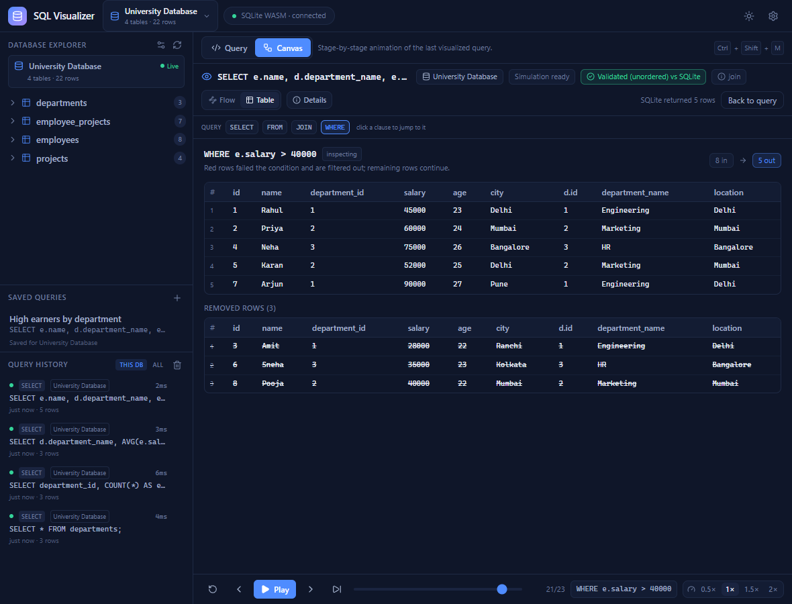
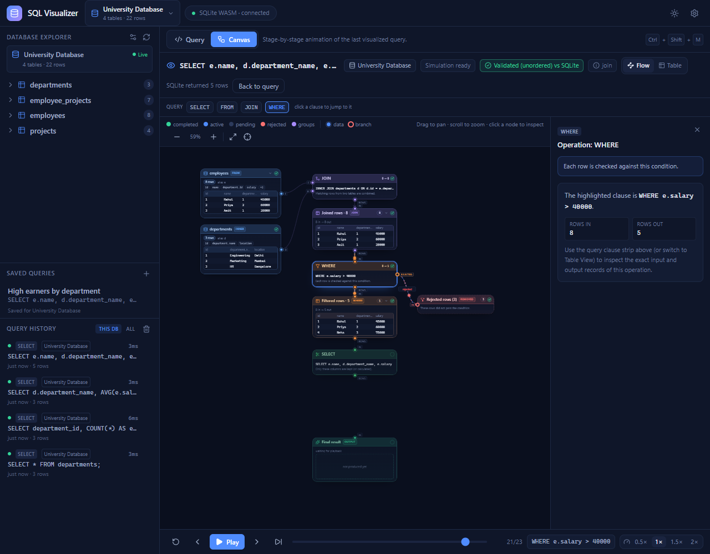
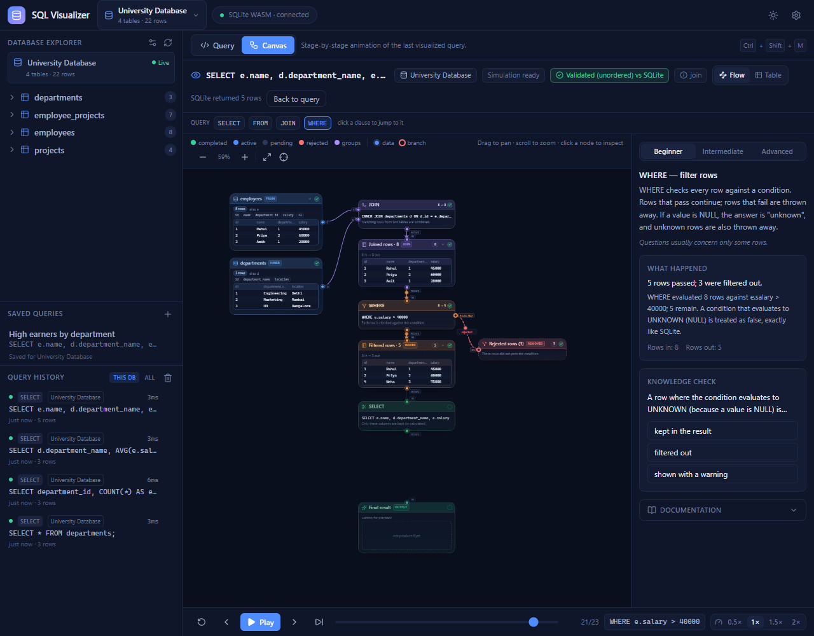
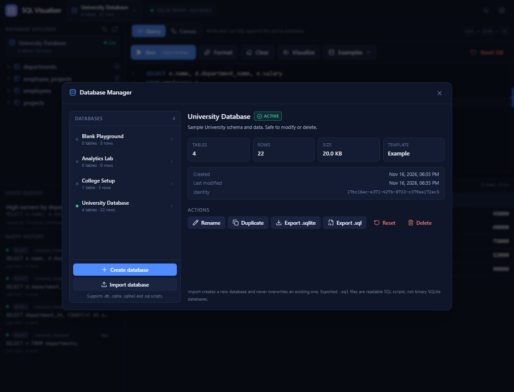
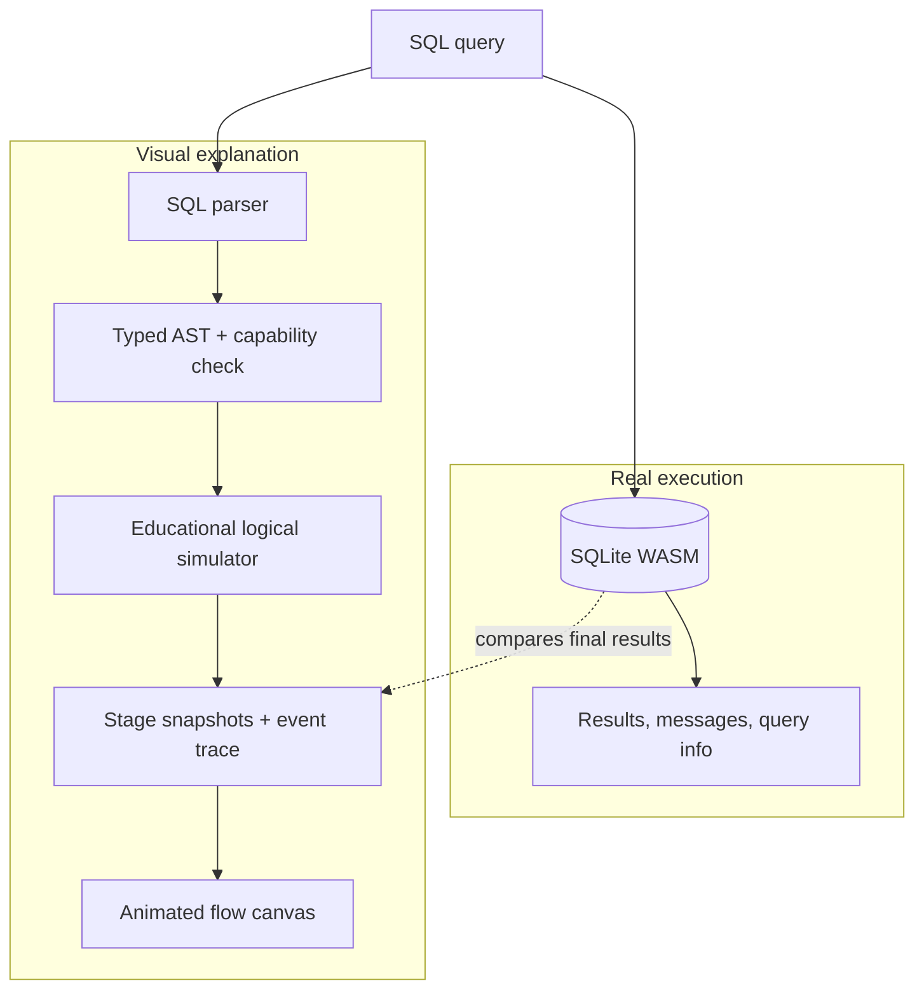

<h1 align="center">
  <br />
  SQL Visualizer
</h1>

<p align="center">
  <b>See what your SQL actually does.</b><br />
  A browser-based SQL playground that runs real SQLite locally and replays supported
  <code>SELECT</code> queries as an animated, inspectable data-flow graph.
</p>

<p align="center">
  
  
</p>

<p align="center">
  <a href="#preview">Preview</a> ·
  <a href="#features">Features</a> ·
  <a href="#how-it-works">How it works</a> ·
  <a href="#quick-start">Quick start</a> ·
  <a href="#documentation">Documentation</a> ·
  <a href="#roadmap">Roadmap</a> ·
  <a href="#contributing">Contributing</a>
</p>

<p align="center">
  <a href="#quick-start"><b>Run it locally →</b></a> &nbsp;·&nbsp;
  <a href="docs/ARCHITECTURE.md">Read the architecture</a>
</p>

<p align="center">
  
</p>

<p align="center">
  <sub>The Query workspace: database explorer, Monaco editor, saved queries, history and real SQLite results.</sub>
</p>

---

## Why it feels different

| 🎬 Learn by seeing | 🔒 Local by design | ✅ Real results first |
|:---|:---|:---|
| Every stage of a query becomes a node you can step through, with real row counts and inspectable snapshots — including the rows a filter rejects. | SQLite runs as WebAssembly inside the tab. No backend, no account, and no query data leaves your machine. | SQLite executes the query for real. The visual simulator then checks its final result against SQLite's output instead of inventing one. |

SQL Visualizer is not a mock database diagram. It is a working SQL workspace with an educational
execution model layered on top: write SQL, run it against SQLite, then switch to a Blender-inspired
canvas and watch the logical pipeline process the same data.

## Preview

<p align="center">
  
</p>

<p align="center">
  <sub><b>Playback</b> — a real <code>SELECT</code> moving through FROM → JOIN → WHERE → SELECT. Rejected rows branch off at the filter.</sub>
</p>

<table>
  <tr>
    <td width="50%" align="center" valign="top">
      
      <br />
      <sub><b>Flow canvas</b> — source tables, operations, intermediate results and a final result node.</sub>
    </td>
    <td width="50%" align="center" valign="top">
      
      <br />
      <sub><b>Table view</b> — the same playback, focused on row-level transformations.</sub>
    </td>
  </tr>
  <tr>
    <td width="50%" align="center" valign="top">
      
      <br />
      <sub><b>Node inspector</b> — click a node for its clause, row counts and, where available, the underlying rows.</sub>
    </td>
    <td width="50%" align="center" valign="top">
      
      <br />
      <sub><b>Synchronized theory</b> — explanations, real counts and knowledge checks follow the active stage.</sub>
    </td>
  </tr>
  <tr>
    <td width="50%" align="center" valign="top">
      
      <br />
      <sub><b>Database manager</b> — create, rename, duplicate, reset, import and export independent databases.</sub>
    </td>
    <td width="50%" align="center" valign="top">
      
      <br />
      <sub><b>Schema viewer</b> — columns, keys, indexes and the original DDL for every table.</sub>
    </td>
  </tr>
</table>

## Features

### 🎬 Visual SQL learning

| Feature | What it does |
|:---|:---|
| **Animated data-flow canvas** | Renders the logical query pipeline as connected nodes: sources, joins, filters, grouping, projection and the final result. |
| **Stage-by-stage playback** | Play, pause, step, seek, restart or change speed (0.5×–2×). Snapshots carry real rows through every stage. |
| **Synchronized table view** | Switch from Flow to Table to inspect accepted, filtered, duplicated, grouped or skipped rows for the current stage. |
| **Node inspector** | Click a node to see its operation and input/output counts, plus row previews for source, intermediate, branch, group and final nodes. |
| **Synchronized explanations** | Beginner, Intermediate and Advanced explanations update with the active stage, alongside documentation links and optional knowledge checks. |

### 🧑‍💻 SQL workspace

| Feature | What it does |
|:---|:---|
| **Monaco SQL editor** | Syntax highlighting, schema-aware autocomplete and `Ctrl/Cmd + Enter` to run. |
| **Real SQLite execution** | Queries execute against SQLite compiled to WebAssembly — results are not simulated. |
| **Results, messages and query info** | Tabbed output with inferred display types, row counts, execution time and error messages. |
| **Saved queries and history** | Named queries and an execution log persist across refreshes; history can be filtered by database. |
| **Query / Canvas toggle** | Both workspaces stay mounted, so editor state, results, zoom, selection and playback survive the switch. `Ctrl/Cmd + Shift + M`. |

### 🗄️ Database workspace

| Feature | What it does |
|:---|:---|
| **Multiple independent databases** | Each database has its own SQLite file and schema. History and saved queries are tagged with the database they belong to, and history can be filtered to the active database. |
| **Templates and custom SQL** | Start blank, load the University example, or create a database from your own setup script. |
| **Import and export** | Import an existing SQLite file; export a database as `.sqlite` or as SQL. |
| **Persistent and local** | Database bytes, metadata, history and saved queries live in IndexedDB in your browser. |
| **Schema explorer** | Browse tables and columns, inspect keys and indexes, and open the original `CREATE TABLE` statement. |

## How it works



SQLite is always the source of truth. The simulator is an **educational logical model**, not SQLite's
physical query plan: it applies the stages to real table data, records immutable snapshots, and then
validates its final result against SQLite — ordered when `ORDER BY` fully determines the order,
unordered otherwise. If a construct cannot be modeled faithfully, the app explains why instead of
guessing.

<details>
<summary><b>Pipeline stages the simulator can replay</b></summary>

| Stage | What it shows |
|:---|:---|
| `FROM` | Source rows read from the live database. |
| `JOIN` | Matched rows from INNER, LEFT and CROSS joins. |
| `WHERE` | Rows accepted or rejected by the filter predicate. |
| `GROUP BY` | Rows collected into groups. |
| `HAVING` | Groups accepted or rejected by the group predicate. |
| `SELECT` | Projected columns and computed values. |
| `DISTINCT` | Duplicate projected rows removed. |
| `ORDER BY` | Rows sorted by the requested keys. |
| `LIMIT` / `OFFSET` | Rows kept or skipped at the end of the pipeline. |

</details>

<details>
<summary><b>Scope and honest limits</b></summary>

- Visualization is for **single SELECT statements**. DDL and DML still execute normally in SQLite, but are not visualized.
- Supported joins: INNER, LEFT and CROSS. Comma cross joins are not supported.
- Supported expressions include comparisons, `AND`/`OR`/`NOT`, `IN`, `BETWEEN`, `IS NULL`, `LIKE`, arithmetic and `COUNT`/`SUM`/`AVG`/`MIN`/`MAX`.
- Not yet visualizable: CTEs, compound selects (`UNION` / `INTERSECT` / `EXCEPT`), subqueries, and other constructs the parser cannot model conservatively.
- Large inputs are capped for visualization (500 rows, 2,000 events). The real SQLite result remains complete and is never truncated.

See [docs/FEATURES.md](docs/FEATURES.md) for the full capability and limitation matrix.

</details>

## Technology

| Layer | Stack |
|:---|:---|
| **Frontend** | React 19.3 · TypeScript 7.0 · Vite 8.3 · Tailwind CSS 4.3 |
| **SQL engine** | SQLite via sql.js 1.16 (WebAssembly) · node-sql-parser 5.4 · Monaco Editor 0.57 with `@monaco-editor/react` 4.7 |
| **State and persistence** | Zustand 5.1 · idb 8.0 (IndexedDB) |
| **Visualization** | Custom SVG/DOM flow canvas · Motion 14.12 · Lucide React 1.72 |
| **Testing and tooling** | Vitest 5.1 · Testing Library 16.3 · jsdom 31.0 · oxlint 1.90 |

## Quick start

**Requirements:** Node.js `20.19+` or `22.12+`, npm, and a modern browser with WebAssembly and IndexedDB.

```bash
git clone https://github.com/Student-Abhishekkumar/SQL-Visualizer.git
cd SQL-Visualizer
npm install
npm run dev
```

Open <http://localhost:5173>. The University example database is created on first launch.

| Command | What it does |
|:---|:---|
| `npm run dev` | Start the Vite development server. |
| `npm run build` | Type-check and build production assets to `dist/`. |
| `npm test` | Run the full Vitest suite (22 files, 319 tests). |
| `npm run lint` | Lint the project with oxlint. |
| `npm run typecheck` | Run the TypeScript project build without emitting. |

## Project structure

```text
src/
├─ app/                   App shell, theme provider, Monaco setup
├─ components/
│  ├─ editor/             Monaco SQL editor, toolbar, example queries
│  ├─ database/           Explorer, manager, schema viewer, database selector
│  ├─ results/            Results table, messages, query information
│  ├─ visualization/      Flow canvas, playback, table view, inspector, explanations
│  └─ layout/             Navbar, sidebar, workspace toggle, settings
├─ services/
│  ├─ database/           SQLite WASM engine, multi-database manager, seed data
│  ├─ sql/                Parsing and SQL formatting
│  ├─ visualization/      AST interpreter, capability analyzer, simulator, graph builder
│  └─ persistence/        IndexedDB persistence and migration
├─ store/                 Zustand stores for database, editor, history, UI and playback
├─ types/                 Shared TypeScript contracts
└─ test/                  Test setup helpers
docs/                     Architecture, feature reference, development guide and assets
public/                   Static assets
```

Only the directories that matter for orientation are shown; component-level tests live next to
their implementation.

## What a query becomes

```sql
SELECT d.department_name,
       COUNT(*)      AS employees,
       SUM(e.salary) AS payroll
FROM employees AS e
JOIN departments AS d ON d.id = e.department_id
WHERE e.salary > 30000
GROUP BY d.department_name
HAVING COUNT(*) >= 2
ORDER BY payroll DESC;
```

SQLite returns three rows from the University example:

| department_name | employees | payroll |
|:---|---:|---:|
| Marketing | 3 | 152000 |
| Engineering | 2 | 135000 |
| HR | 2 | 110000 |

Press **Visualize** and the same query unfolds as:

`FROM employees` → `JOIN departments` → `WHERE salary > 30000` → `GROUP BY department_name` → `HAVING COUNT(*) >= 2` → `SELECT` → `ORDER BY payroll DESC`

Each node carries real row counts; filtered rows branch off at the WHERE gate, grouping collects
rows into visible groups, and the final node shows the projected result. Because `ORDER BY` fully
determines the order, the workspace reports **Validated (ordered) vs SQLite**.

## Roadmap

The roadmap is directional, not a release commitment.

### ✅ Shipped

- [x] Real SQLite execution in the browser via WebAssembly
- [x] Monaco SQL editor with results, messages and query information
- [x] Multiple independent databases with templates, custom SQL, import/export and IndexedDB persistence
- [x] Animated logical pipeline with stage snapshots, playback and speed control
- [x] Flow and Table views, node inspector, synchronized explanations and knowledge checks
- [x] SQLite result-parity validation and conservative unsupported-query reporting

### 🚧 In progress

- [ ] Broader SELECT coverage in the simulator: subqueries, CTEs and compound selects
- [ ] More guided exercises built on the existing explanation and knowledge-check panels

### 🧭 Planned

- [ ] Shareable visualization traces
- [ ] Export a visualization as an image or recording
- [ ] A hosted public demo build

## Documentation

| Document | Contents |
|:---|:---|
| [Architecture](docs/ARCHITECTURE.md) | Runtime paths, simulator guarantees, validation, graph/playback state and persistence. |
| [Feature reference](docs/FEATURES.md) | Complete feature matrix, supported SQL constructs and known limitations. |
| [Development guide](docs/DEVELOPMENT.md) | Local setup, scripts, test strategy, conventions and change checklist. |
| [Assets](docs/assets/) | Screenshots and the playback recording used in this README. |

## Contributing

Contributions are welcome — especially tests, simulator coverage and accessibility fixes.

1. Fork the repository and create a focused branch.
2. Run `npm install` and `npm test` to confirm the baseline.
3. Make the change; add tests when touching the parser, simulator, validation or playback.
4. Run `npm run lint`, `npm run typecheck` and `npm test`.
5. Open a pull request describing the change; include a screenshot for UI work.

For larger changes, open an issue first so the approach can be discussed. See the
[development guide](docs/DEVELOPMENT.md) for architecture conventions and a pre-PR checklist.

## License

No `LICENSE` file is currently included in this repository, so no reuse license is granted by
default. The source is publicly available for reading and learning. If you would like to reuse the
code, please open an issue to discuss terms first.

---

<p align="center">
  <sub>Built with SQLite WASM, Monaco, React and a custom flow canvas. The node editor takes visual cues from Blender.</sub><br />
  <sub><a href="#preview">Back to top ↑</a></sub>
</p>
