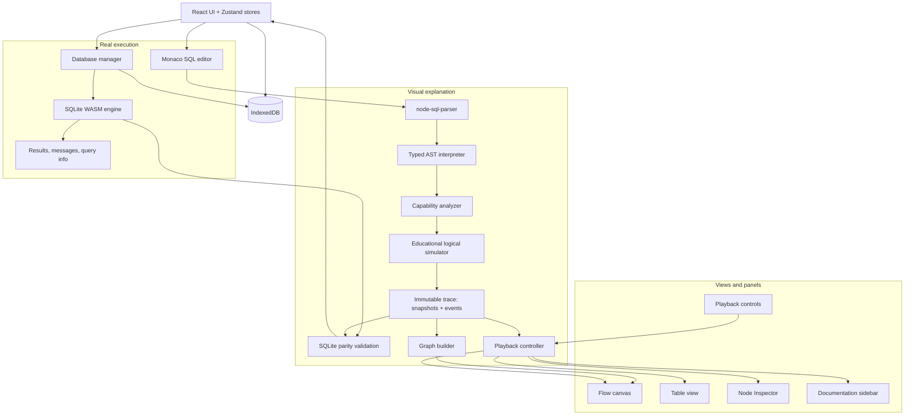

# Architecture

SQL Visualizer is a fully client-side React application. There is no backend, no API and no
telemetry: SQLite is compiled to WebAssembly, while the UI, query history, saved queries and
database files are persisted in the browser's IndexedDB.

The important architectural split is between **real execution** and **visual explanation**:

- SQLite executes every query and produces the authoritative result.
- A separate logical simulator replays supported `SELECT` statements as a sequence of stages,
  then its final output is validated against SQLite.

The two paths share the same SQL text and the same live database, but neither mutates the other.

## Runtime overview



## Real execution path

| Layer | Responsibility | Source |
|:---|:---|:---|
| WASM engine | Load `sql.js`, execute statements, return columns, values, row counts, modified counts and timings. | `src/services/database/sqliteService.ts` |
| Database manager | Own the active SQLite instance, serialize/restore database bytes, and manage per-database lifecycle. | `src/services/database/databaseManager.ts` |
| Database store | Expose open/create/import/export/reset/execute actions to the UI and keep cached metadata in sync. | `src/store/databaseStore.ts` |
| Persistence | Store database metadata, SQLite bytes, active database id, history and saved queries. | `src/services/persistence/persistenceService.ts` |

Execution accepts multiple statements. The normalized result keeps a per-statement breakdown and
mirrors the first result-producing statement for simple consumers. Result rows are never persisted;
history records the SQL text, statement type, timing and row counts.

Database switching is intentionally strict: a visualization trace belongs to the database it was
built from, so switching databases invalidates the trace instead of showing data from the wrong
workspace.

## Visualization path

`visualizationStore.visualize()` orchestrates the pipeline without touching the normal query
execution state:

1. **Parse and classify** one statement with `node-sql-parser`. `SELECT` (including compounds) uses the SELECT interpreter; supported `INSERT`, `UPDATE` and `DELETE` use the DML classifier; supported `CREATE TABLE`, `ALTER TABLE`, `DROP TABLE`, `CREATE INDEX` and `DROP INDEX` use the DDL classifier. A dedicated conservative lexer handles SQLite `DROP INDEX`, which the installed parser does not accept.
2. **Interpret** the AST into a typed query, mutation or schema structure. Unsupported constructs are collected as
   explicit reasons, not silently ignored.
3. **Analyze capability** to derive the stages that will run, the constructs in use, warnings and
   an estimated visualization cost.
4. **Simulate** SELECT against live table data, or execute supported DML/DDL on an isolated byte-copy clone, producing immutable stage snapshots and an ordered event trace.
5. **Validate against SQLite.** SELECT compares final columns, rows and values with the active read-only result; DML compares predicted and actual clone rows; DDL reads the actual post-statement catalog and PRAGMA metadata and checks data-preservation invariants.
6. **Build the flow graph** deterministically from the trace.
7. **Load the trace** into the playback controller, which folds events into the UI view state.

| Stage | Module | What it produces |
|:---|:---|:---|
| Parse | `src/services/sql/sqlParser.ts` | Parser AST and statement classification |
| Interpret | `src/services/visualization/astInterpreter.ts` | `QueryStructure` plus unsupported reasons |
| Analyze | `src/services/visualization/capabilityAnalyzer.ts` | Stages, detected constructs, warnings |
| Simulate | `src/services/visualization/simulator.ts` | Immutable snapshots and event trace |
| Validate | `src/services/visualization/validation.ts` | Parity result against SQLite |
| Layout | `src/services/visualization/graphBuilder.ts` | Nodes, edges, sockets and coordinates |
| Inspect | `src/services/visualization/nodeInspection.ts` | Tab data, row previews, nested inputs |
| Playback | `src/store/visualizationStore.ts` | Folded view state for the current event |
| Render | `src/components/visualization/**` | Canvas, table, inspector and explanations |

### Stage semantics

| Stage | Logical operation |
|:---|:---|
| `FROM` | Load rows from the source table. |
| `JOIN` | Merge rows according to INNER, LEFT or CROSS join semantics. |
| `WHERE` | Evaluate the predicate per row; rejected rows branch off. |
| `GROUP BY` | Collect rows into groups. |
| `HAVING` | Evaluate the group predicate; rejected groups branch off. |
| `SELECT` | Project selected columns and evaluate expressions. |
| `DISTINCT` | Remove duplicate projected rows. |
| `COMPOUND` | Fold independent `SELECT` branches left-to-right with `UNION`, `UNION ALL`, `INTERSECT` or `EXCEPT`, recording each operation's actual inputs, output and removed rows. |
| `ORDER BY` | Sort rows using the requested keys. |
| `LIMIT` / `OFFSET` | Keep or skip rows at the end of the pipeline. |
| `TARGET` | Capture real target rows in the isolated copy before DML. |
| `INPUT` / `COLUMN_MAPPING` | Show INSERT input rows and their target-column associations. |
| `INSERT` / `DELETE` | Show rows SQLite actually inserted or deleted in the copy. |
| `MATCHED_ROWS` | Show matched rows and the untouched unmatched branch. |
| `SET` / `CHANGED_ROWS` / `UNCHANGED_ROWS` | Show assigned values, actual changes and matched-but-unchanged rows. |
| `RETAINED_ROWS` / `FINAL_TABLE` | Show retained rows and the authoritative post-statement table. |
| `DATABASE` / `RESULTING_SCHEMA` / `REMAINING_SCHEMA` | Read real `sqlite_master` catalog rows before or after DDL. |
| `TABLE_DEFINITION` / `COLUMN_DEFINITIONS` / `CONSTRAINTS` | Show stored CREATE SQL, `PRAGMA table_xinfo` columns, indexes and foreign keys. |
| `ORIGINAL_SCHEMA` / `ALTER_OPERATION` / `SCHEMA_TRANSFORMATION` | Capture the original object, one ALTER action and the resulting columns. |
| `DROP_TABLE` / `REMOVED_TABLE` | Show the isolated drop and its real pre-drop definition. |
| `INDEX_DEFINITION` / `CREATE_INDEX` / `INDEX_METADATA` | Show actual index SQL, isolated creation and PRAGMA key metadata. |
| `EXISTING_INDEX` / `DROP_INDEX` / `REMAINING_INDEXES` | Show the pre-drop index, isolated removal and surviving table indexes. |

Snapshots carry row roles (`accepted`, `filtered`, `duplicated`, `selected`, `skipped`, `grouped`)
so every panel can explain not just what survived, but what was removed and why.

### Projection and column naming

Projection items are stored per item, in source order. A wildcard is a `StarExpr` with an optional
table qualifier, so bare `*`, `table.*` and mixed lists such as `t.*, u.*` or `*, id` stay distinct;
`selectAll` survives only as a convenience flag for a list that is exactly one unqualified `*`.
`astInterpreter` checks every wildcard qualifier against the block's FROM/JOIN tables and aliases and
rejects an unknown qualifier before simulation.

The simulator keeps three aligned label lists per block:

- `columnLabels` — qualified internal resolution names (`e.id`), used to resolve references and
  disambiguate joined columns.
- `displayLabels` — intermediate snapshot names, shown while the pipeline runs.
- `sourceColumnNames` — the SQLite output names for source columns (`id`, not `u.id`).

`projectRows` expands each wildcard against `columnLabels` and emits `displayLabels` for stage
snapshots but `sourceColumnNames` for the block's final columns. Thus `VisualizationTrace.finalColumns`
matches SQLite's names for wildcard projections, CTEs and CTE self-joins, while intermediate snapshots
may keep qualified labels for clarity. Compound output names still come from the first branch.

Output aliases are resolved structurally in `WHERE`, `GROUP BY` and `HAVING` by substituting the
aliased expression, never by substituting text. A source column with the same name takes precedence,
aliases are not re-resolved inside other aliased expressions, and aggregate expression text is kept
intact so per-group evaluation still finds its precomputed value.

### SQLite affinity and collation

`readTableFromDb` combines live rows with comparison metadata: `PRAGMA table_info` supplies declared
types, and the table's `sqlite_master` DDL supplies column collation declarations. `sqliteAffinity.ts`
derives INTEGER, TEXT, REAL, NUMERIC or BLOB affinity using SQLite's ordered substring rules. Metadata
travels alongside columns through joins, projections, CTEs, scalar/`IN` subqueries and compound branches;
computed expressions and fixtures without schema metadata retain unknown affinity. It is internal
execution metadata, not part of row identity or the persisted trace format.

Scalar comparisons apply affinity only to the operand required by SQLite's rules. Numeric affinity
converts well-formed numeric text; TEXT affinity converts numeric literals using their integer/real
storage class (`10` → `'10'`, `10.0` → `'10.0'`). Two columns that both have affinity do not coerce each
other. Final comparison uses SQLite storage-class ordering (numbers, text, then blobs), bytewise BLOB
ordering and the selected collation. Stored values are never rewritten, and existing NULL/three-valued
logic remains in the evaluator.

The expression tree represents explicit `COLLATE BINARY` and `COLLATE NOCASE`. Comparison precedence is
explicit left, explicit right, declared left, declared right, then BINARY. NOCASE folds ASCII letters
only. The same expression metadata drives `GROUP BY`, `DISTINCT`, aggregate `DISTINCT`, `MIN`/`MAX`,
`ORDER BY` and distinct compound operators; UNION ALL performs no collation-sensitive deduplication.
An explicit supported collation replaces an unsupported declaration for that expression. Otherwise a
declared collation such as RTRIM causes the affected operation to abort with a clear reason instead of
silently claiming BINARY parity.

### Query blocks and dependencies

A statement is a tree of query blocks, not a single pipeline. The root `SELECT` plus every nested
block — scalar, `IN` / `NOT IN`, `EXISTS` / `NOT EXISTS`, each CTE body, and each `UNION` /
`UNION ALL` / `INTERSECT` / `EXCEPT` branch — gets a deterministic id (`q1`, `q2`, …) from
`astInterpreter`, together with `blockKind`, `parentId`, `depth` and the outer `consumingStage`. Stage keys are block-scoped
(`stageKeyFor`), so nested stages never collide with root stages. Non-final compound operations also
receive deterministic operation keys (`COMPOUND-1`, `COMPOUND-2`, …), while the final operation keeps
`COMPOUND` for compatibility. `queryBlocks.ts` exposes the block list, per-block snapshots and
per-block event timelines to the pipeline selector, canvas and playback.

Each nested block is evaluated once, from live data, before the stage or compound result that consumes
it, through the same logical simulator:

- **Scalar subqueries** produce a single value (empty → `NULL`, multiple rows → first row, exactly
  one column).
- **`IN` / `NOT IN`** blocks must return one column; their real values are kept as a list and the
  outer predicate applies SQLite three-valued logic (empty set, `NULL` left operand, `NULL` member).
- **`EXISTS` / `NOT EXISTS`** blocks reduce to row presence; the column count is irrelevant.
- **CTEs** are independent inputs. The body is simulated as a real relation; explicit column lists
  are honoured, earlier CTEs are in scope, and forward/self references are rejected.
- **Compound branches** are full, independent query blocks. The synthetic compound root owns the
  trailing `ORDER BY` / `LIMIT` / `OFFSET` and any root `WITH`, evaluates the CTEs once, then simulates
  each branch through `simulateQuery`. Operators fold strictly left-to-right: `A UNION B INTERSECT C`
  means `(A UNION B) INTERSECT C`, not `A UNION (B INTERSECT C)`. `UNION` removes duplicates across the
  accumulated result, `UNION ALL` preserves them until a later distinct operator, `INTERSECT` keeps
  distinct rows present in both inputs, and `EXCEPT` keeps distinct left rows absent from the right.
  Complete rows use NULL-safe keys, so corresponding NULLs compare equal. Branches must return matching
  column counts, and the first branch names the output columns. Each operation records its accumulated
  left input, next right input, retained rows, excluded rows and duplicates in
  `VisualizationTrace.compound.operations`; the final operation also supplies the root `COMPOUND`
  snapshot used by Table View and validation.

Each block's immutable snapshots and events live in `VisualizationTrace.nestedQueries`, and its real
output rows become a `subquery` source table whose `consumerStage` names the outer stage that uses
the value. `cteDependenciesOf` records real dependency edges — including CTE reads performed inside a
nested scalar/`IN`/`EXISTS` block, via `viaBlockId` — and `graphBuilder` wires those edges between
the dependency block's output and the consuming operation, so hover and click tracing follow them.
Compound branches are recorded in `VisualizationTrace.compound.branches`, and each operation in
`VisualizationTrace.compound.operations`. The first operation consumes the first two branch subgraphs;
later operations consume the previous operation and their next branch. Each operation has deterministic
nodes and edges, so selecting or hovering it traces only its actual upstream operations and branches.
The inspector reads the operation's real left/right inputs and output, including excluded and duplicate
rows, rather than reconstructing them from the final result. Nested values are cached per simulation and
are never re-executed when inspecting a node.

Truncation and incompleteness propagate through these edges: a capped CTE, nested block, compound
branch or intermediate operation marks its dependents and the outer trace incomplete with a named reason,
and validation refuses to certify an incomplete result. Correlation is detected against real column names
(`correlation.ts`) before a block runs; correlated scalar, `IN` and `EXISTS` blocks abort with an
explicit reason instead of using invented per-row values. This remains an educational logical model,
not SQLite's physical plan.

## Isolated DML preview (Stage 8D)

`validation.ts` routes INSERT, UPDATE and DELETE to `previewDml` before the read-only SELECT path. `dmlInterpreter.ts` is the centralized conservative gate: it accepts one single-table INSERT VALUES/SELECT/DEFAULT VALUES, UPDATE SET with optional WHERE, or DELETE with optional WHERE. Unsupported conflict clauses, RETURNING, DML subqueries/functions, joins/aliases, multiple statements and other statement types are rejected before preview execution.

`previewDml` reads `activeDb.exportSnapshot()` once and constructs a separate sql.js database with `SQLiteDatabase.createFromSnapshot`. Only that clone receives `executeBatch`. It has foreign keys enabled, is never registered with `databaseManager`, and is closed in `finally` on success, constraint failure, unsupported target or parity failure. No persistence or active-selection API is called. Normal Run continues through the existing writable database store.

The preview captures real target rows before and after execution using stable SQLite rowids. INSERT shows input rows and actual column mappings; UPDATE uses the shared row evaluator to predict matches and assignments, then compares stored before/after values to distinguish changed and matched-but-unchanged rows; DELETE classifies matched, deleted and retained rows. INSERT defaults and generated ids are predicted for the educational intermediate stages, while the inserted/final stages and affected count come from actual SQLite execution. A complete final-table multiset comparison is mandatory: a mismatch discards the trace. Targets above 500 rows, triggers, foreign-key cascade actions, generated columns, WITHOUT ROWID tables and rowid-changing updates are rejected rather than hiding side effects or incomplete state.

DML traces use the same `VisualizationTrace`, snapshots, events, graph builder, inspector, FlowCanvas, Table View and playback store as SELECT. TARGET is a real source-table connection; MATCHED_ROWS exposes an unmatched branch; FINAL_TABLE is the real isolated post-statement table. These stages explain logical mutation flow, not SQLite bytecode or physical planning.

## Isolated DDL schema preview (Stage 8E)

`validation.ts` routes CREATE, ALTER and DROP to `previewDdl`. `ddlInterpreter.ts` admits one main-database `CREATE TABLE` with explicit columns, one ALTER TABLE rename-table/rename-column/add-column/drop-column action, `DROP TABLE`, ordinary/UNIQUE/expression/partial `CREATE INDEX`, or `DROP INDEX`. Temporary tables, CTAS, views, triggers, schema-qualified objects, batches and unrelated DDL are rejected before cloning. `ddlStagesFor` and `analyzeDdlCapability` describe the same operation-specific stages that the trace emits.

The active connection is used only for `exportSnapshot()`. `previewDdl` creates an independent database with `SQLiteDatabase.createFromSnapshot`, runs only there, and closes it in `finally` after success, SQLite errors, guard rejection or trace-building failure. It never registers the clone, changes selection, calls the active executor or persists bytes. Normal Run still uses the writable database store.

`ddlSchema.ts` captures before/after states exclusively from `sqlite_master`, `PRAGMA table_xinfo`, `foreign_key_list`, `index_list`, `index_xinfo` and real `SELECT *` reads. Catalog rows include automatic constraint indexes; expression index keys stay null instead of receiving invented names. CREATE/DROP IF EXISTS variants produce explicit no-op traces. ALTER and index operations compare complete before/after row multisets (all surviving columns for column changes) and discard the trace on unexpected data changes. DROP TABLE rejects incoming foreign-key ON DELETE actions other than NO ACTION so unseen child-table mutations cannot be presented as a target-only preview.

DDL snapshots carry `schema` alongside display-friendly metadata rows. The existing graph builder, node inspector, Table View, explanations and playback consume those snapshots without a separate UI stack. Validation reports zero SQL result rows and describes the real isolated introspection; tests independently execute the same statement on a second reference clone and compare the resulting schema.

## Simulator guarantees

The simulator is designed to be trustworthy rather than impressive:

- **Live data only.** It reads through an accessor backed by the active SQLite database. Nothing is
  hardcoded or mocked.
- **Read-only SELECT simulation.** The SELECT pipeline never mutates database state. DML and DDL are handled separately on the isolated copies described above.
- **Deterministic.** The same database, query and options produce the same snapshots and events.
- **Stable identities.** Every visualized row has an id that survives filtering, sorting and
  grouping; ids are not derived from array positions.
- **Explicit failure.** Unsupported or unresolvable constructs abort with reasons instead of
  producing a misleading trace.
- **Bounded work.** Visualization is capped at 500 rows and 2,000 events; source previews show up
  to 12 rows. Truncation is reported and never affects real SQLite results.

This is a **logical** execution model, not SQLite's physical query plan. The simulator does not
claim to expose bytecode, indexes or the query planner.

## Validation strategy

Validation compares the trace's final result with SQLite's real result:

- Column labels are compared leniently (case and whitespace insensitive).
- Row counts must match.
- Values must match, with a small relative tolerance for floating-point results.
- Order is compared only when the trace proves a fully determined order (`ORDER BY` without ties).
  Otherwise multiset equality is used, because SQLite does not guarantee row order.

Nested blocks are validated independently too: `validateNestedBlocks` runs each block's own SQL
against SQLite (re-declaring prerequisite CTE definitions for blocks that read a CTE) and reports a
per-block outcome. Compound branches are plain `SELECT` blocks, so each one is validated this way
while the folded compound result is validated as a whole. Intermediate operation snapshots are
inspection data, not independent parity claims. Truncated or incomplete blocks and operations are marked
skipped and never reported as validated, and an incomplete outer simulation cannot claim parity even
when the capped result happens to match SQLite.

A mismatch is surfaced in the workspace with detail rather than hidden. The real SQLite result is
never altered to make validation pass. DML uses a complete final-table comparison on its clone. DDL has no row result set to compare: its authority is the clone's post-execution `sqlite_master` and PRAGMA state, plus mandatory row-preservation checks for ALTER and index operations. Safety tests also compare active and IndexedDB bytes before and after every preview path.

## Playback and synchronization

The trace is immutable. Playback only changes an event index, so seeking backward and forward is
deterministic and cheap. `visualizationStore` folds events up to the current index into a
`VisualizationViewState` (active stage, current snapshot, completed stages, finished flag).

That single view state drives:

- node status, revealed edges and branch emphasis on the flow canvas,
- the clause strip and Monaco clause highlight,
- the synchronized table view,
- the floating node inspector and the documentation sidebar,
- the playback controls and speed selection.

Each query block also has its own event timeline. Compound operations appear in left-to-right order
with their own snapshots and operation keys; the final operation retains the shared `COMPOUND` key,
followed by compound `ORDER BY` and `LIMIT`. Selecting a branch plays that branch's own pipeline from
its source tables to its projected rows. Table View follows the final compound result, while the
inspector can show any completed operation's actual inputs and removed rows.

Both Query and Canvas workspaces stay mounted. Switching views therefore preserves editor
content, results, canvas pan/zoom, node selection and playback position.

## Canvas architecture

`graphBuilder` computes a deterministic layout from the trace:

- source tables in a left column, aligned with the operation that consumes them,
- the pipeline spine down the center,
- rejected rows and group nodes fanning out to the right,
- sockets and edge routing computed separately from rendering.

`FlowCanvas` renders HTML nodes and SVG wires, reveals elements only when their data exists, and
keeps interaction independent from playback state. It owns transient camera and pointer state:

- **Pan and zoom:** pointer drag and wheel gestures update a local camera; fit and reset derive a
  new camera from the graph bounds.
- **Node dragging:** pointer capture moves a node within the canvas, including left-of-origin graph
  coordinates, and settles nearby collisions; a drag never selects the node or opens the inspector.
- **Hover and click tracing:** hover emphasizes the upstream path for that node; click pins the
  selection and opens the inspector. Both use the graph's real edges, including branch edges.

Query semantics stay in the services; the canvas renders whatever the graph builder produces.

## Node Inspector architecture

The inspector is a single persistent window, not one window per node. Its geometry and mode are
owned by `VisualizationWorkspace`, so they survive node switches, playback updates, closing and
reopening:

| State | Owner | Meaning |
|:---|:---|:---|
| `inspectorRect` | Workspace | Saved expanded rectangle (position, width, height). |
| `inspectorMode` | Workspace | `expanded`, `collapsed` or `minimized`. |
| `inspectorBounds` | Workspace | Measured canvas layer used for clamping. |
| `liveRect` | Inspector | Transient rectangle during an in-flight drag or resize. |
| Active tab | Inspector | Overview, Input, Output or Details. |

The visible rectangle is derived from the saved rectangle:

- **Expanded:** `clampRect` keeps the full rectangle inside the workspace and enforces the minimum
  readable size.
- **Collapsed:** the visible box is rebuilt at `INSPECTOR_HEADER_HEIGHT` (52px). Its position is
  clamped with `clampPosition`, which preserves dimensions exactly, so the header can reach the
  bottom of the workspace without the expanded minimum height inflating it.
- **Minimized:** the window is hidden and a dock chip represents it.

`floatingWindow.ts` contains the pure geometry helpers: `clampRect`, `clampPosition`, `moveRect`,
`resizeRect`, `maximizeRect`, `defaultRect` and `rectNearAnchor`. `moveRect` never resizes a window;
`resizeRect` anchors the opposite edge and enforces minimum sizes.

Pointer interaction is centralized in one handler for both expanded and collapsed modes. The
persistent header starts a move, resize handles start a resize, and header buttons stop propagation.
Pointer capture is used where supported, and pointer-up and pointer-cancel both commit the gesture.
Because only the rectangle changes during playback, the selected node's data updates without
resetting the window's position, size or mode.

The collapsed state removes the content and resize handles from the rendered tree instead of hiding
them. The outer element's height is the real header height, and the drag rectangle is the same
header-height box. Expanding restores the saved expanded height, width, position and tab.

## Learning and explanation architecture

`explanations.ts` holds the educational content as data:

- per-stage descriptions at beginner, intermediate and advanced levels,
- the "what happened" summary derived from the active snapshot,
- curated SQLite documentation links,
- optional knowledge checks for selected stages (beginner and intermediate only).

`ExplanationPanel` renders that content, including the knowledge-check state. `DocumentationSidebar`
wraps the panel in an independently toggleable sidebar:

- it stays mounted while closed, preserving scroll position, learning level and answer state,
- it is a real flex column on wide layouts and an overlay on narrow ones,
- closing moves focus back to the header toggle; opening from the edge tab focuses the panel,
- `Escape` closes it,
- a compact edge tab keeps it reachable while closed.

The workspace passes the current playback snapshot or the inspected node's stage, so theory and
visualization stay synchronized.

## State and persistence

| Zustand store | State |
|:---|:---|
| `databaseStore` | Active database, database list, schema, last result, execution status |
| `editorStore` | SQL text and current clause highlight |
| `historyStore` | Query history and saved named queries |
| `uiStore` | Theme, active workspace view (Query by default and session-only), sidebar state, modals, learning level |
| `visualizationStore` | Trace, playback position, speed, validation and status |

Playback state also carries a session id so a new trace or database switch cannot leave stale
status or validation text attached to a different query.

IndexedDB database `sql-visualizer` (version 2) contains:

| Store | Contents |
|:---|:---|
| `databases` | Database metadata records |
| `snapshots` | Serialized SQLite bytes keyed by database id |
| `app` | Small key/value state such as the active database id |
| `history` | Executed query log |
| `queries` | Saved named queries |

Version 1 used a single `database` snapshot. It is kept during upgrade so the legacy workspace can
be migrated into a normal database record without data loss.

## Failure states

The visualization workspace distinguishes:

- `idle` — nothing has been visualized yet,
- `ready` — a trace is loaded; the validation outcome, if one was produced, is available,
- `unsupported` — the query cannot be modeled faithfully; reasons are listed,
- `unavailable` — no database or no query is available.

Unsupported SELECT, DML and DDL forms still execute normally through Run; Visualize reports why no faithful trace is available. Supported DML and DDL use isolated previews, so Visualize never applies their changes to the active workspace. This separation keeps the SQL workspace useful even when the educational model does not apply.

### Current compound-query limits

- Recursive CTEs (`WITH RECURSIVE`) and correlated subqueries are rejected with explicit reasons.
- Nested compound forms are not covered by the general compound fallback; in particular,
  `INTERSECT` and `EXCEPT` inside subqueries or CTE bodies are not visualized.
- `INTERSECT ALL`, `EXCEPT ALL`, `UNION DISTINCT` and `INTERSECT DISTINCT` are rejected rather than
  approximated. Root clauses must follow the final set operator; branch-level `ORDER BY`, `LIMIT` and
  `OFFSET` are rejected.
- A capped or incomplete branch or operation is disclosed and never presented as fully validated,
  even when the visible rows happen to match SQLite.

## Source map

```text
src/services/
├─ database/        sql.js wrapper, multi-database manager, seed data, templates
├─ sql/             parser wrapper and SQL formatter
├─ visualization/   interpreter, analyzer, simulator, validation, graph layout,
│                   inspection, explanations, window geometry
└─ persistence/     IndexedDB storage and legacy migration

src/components/visualization/
├─ flow/            canvas, node renderers, wires, inspector, minimized dock
├─ VisualizationWorkspace.tsx
├─ DocumentationSidebar.tsx
├─ ExplanationPanel.tsx
├─ PipelinePanel.tsx
├─ TransformationPanel.tsx
└─ PlaybackControls.tsx
```

## Where to start reading

- **Execution:** `src/services/database/sqliteService.ts` and `src/store/databaseStore.ts`
- **Simulation:** `src/services/visualization/simulator.ts`, starting at `simulateQuery`
- **Query blocks and dependencies:** `src/services/visualization/queryBlocks.ts`,
  `correlation.ts` and `graphBuilder.ts`
- **Validation:** `src/services/visualization/validation.ts`, starting at `simulateAndValidate`
- **Canvas:** `src/services/visualization/graphBuilder.ts` and `src/components/visualization/flow/FlowCanvas.tsx`
- **Playback:** `src/store/visualizationStore.ts`, starting at `foldEvents`
- **Inspector:** `src/components/visualization/flow/FloatingNodeInspector.tsx`,
  `src/components/visualization/VisualizationWorkspace.tsx` and
  `src/services/visualization/floatingWindow.ts`
- **Learning content:** `src/services/visualization/explanations.ts`,
  `src/components/visualization/ExplanationPanel.tsx` and
  `src/components/visualization/DocumentationSidebar.tsx`

For supported SQL constructs and known gaps, see [FEATURES.md](FEATURES.md). For setup and test
conventions, see [DEVELOPMENT.md](DEVELOPMENT.md).
