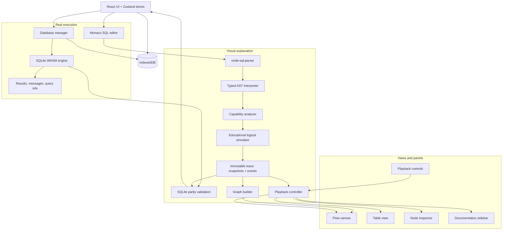

# Architecture

SQL Visualizer is a fully client-side React application. There is no backend, no API and no
telemetry: SQLite is compiled to WebAssembly, while the UI, query history, saved queries and
database files are persisted in the browser's IndexedDB.

The important architectural split is between **real execution** and **visual explanation**:

- SQLite executes every query and produces the authoritative result.
- A separate logical simulator replays supported `SELECT` statements as a sequence of stages,
  then its final output is validated against SQLite.

The two paths share the same SQL text and the same live database, but neither mutates the other.

## Runtime overview



## Real execution path

| Layer | Responsibility | Source |
|:---|:---|:---|
| WASM engine | Load `sql.js`, execute statements, return columns, values, row counts, modified counts and timings. | `src/services/database/sqliteService.ts` |
| Database manager | Own the active SQLite instance, serialize/restore database bytes, and manage per-database lifecycle. | `src/services/database/databaseManager.ts` |
| Database store | Expose open/create/import/export/reset/execute actions to the UI and keep cached metadata in sync. | `src/store/databaseStore.ts` |
| Persistence | Store database metadata, SQLite bytes, active database id, history and saved queries. | `src/services/persistence/persistenceService.ts` |

Execution accepts multiple statements. The normalized result keeps a per-statement breakdown and
mirrors the first result-producing statement for simple consumers. Result rows are never persisted;
history records the SQL text, statement type, timing and row counts.

Database switching is intentionally strict: a visualization trace belongs to the database it was
built from, so switching databases invalidates the trace instead of showing data from the wrong
workspace.

## Visualization path

`visualizationStore.visualize()` orchestrates the pipeline without touching the normal query
execution state:

1. **Parse** the SQL with `node-sql-parser` and confirm it is a single `SELECT`.
2. **Interpret** the AST into a typed query structure. Unsupported constructs are collected as
   explicit reasons, not silently ignored.
3. **Analyze capability** to derive the stages that will run, the constructs in use, warnings and
   an estimated visualization cost.
4. **Simulate** the logical pipeline against live table data, producing immutable stage snapshots
   and an ordered event trace.
5. **Execute for real** and compare the simulator's final columns, row count and values with
   SQLite's result.
6. **Build the flow graph** deterministically from the trace.
7. **Load the trace** into the playback controller, which folds events into the UI view state.

| Stage | Module | What it produces |
|:---|:---|:---|
| Parse | `src/services/sql/sqlParser.ts` | Parser AST and statement classification |
| Interpret | `src/services/visualization/astInterpreter.ts` | `QueryStructure` plus unsupported reasons |
| Analyze | `src/services/visualization/capabilityAnalyzer.ts` | Stages, detected constructs, warnings |
| Simulate | `src/services/visualization/simulator.ts` | Immutable snapshots and event trace |
| Validate | `src/services/visualization/validation.ts` | Parity result against SQLite |
| Layout | `src/services/visualization/graphBuilder.ts` | Nodes, edges, sockets and coordinates |
| Inspect | `src/services/visualization/nodeInspection.ts` | Tab data, row previews, nested inputs |
| Playback | `src/store/visualizationStore.ts` | Folded view state for the current event |
| Render | `src/components/visualization/**` | Canvas, table, inspector and explanations |

### Stage semantics

| Stage | Logical operation |
|:---|:---|
| `FROM` | Load rows from the source table. |
| `JOIN` | Merge rows according to INNER, LEFT or CROSS join semantics. |
| `WHERE` | Evaluate the predicate per row; rejected rows branch off. |
| `GROUP BY` | Collect rows into groups. |
| `HAVING` | Evaluate the group predicate; rejected groups branch off. |
| `SELECT` | Project selected columns and evaluate expressions. |
| `DISTINCT` | Remove duplicate projected rows. |
| `ORDER BY` | Sort rows using the requested keys. |
| `LIMIT` / `OFFSET` | Keep or skip rows at the end of the pipeline. |

Snapshots carry row roles (`accepted`, `filtered`, `duplicated`, `selected`, `skipped`, `grouped`)
so every panel can explain not just what survived, but what was removed and why.

### Query blocks and dependencies

A statement is a tree of query blocks, not a single pipeline. The root `SELECT` plus every nested
block — scalar, `IN` / `NOT IN`, `EXISTS` / `NOT EXISTS`, and each CTE body — gets a deterministic
id (`q1`, `q2`, …) from `astInterpreter`, together with `blockKind`, `parentId`, `depth` and the
outer `consumingStage`. Stage keys are block-scoped (`stageKeyFor`), so nested stages never collide
with root stages. `queryBlocks.ts` exposes the block list, per-block snapshots and per-block event
timelines to the pipeline selector, canvas and playback.

Each nested block is evaluated once, before the outer pipeline, through the same logical simulator:

- **Scalar subqueries** produce a single value (empty → `NULL`, multiple rows → first row, exactly
  one column).
- **`IN` / `NOT IN`** blocks must return one column; their real values are kept as a list and the
  outer predicate applies SQLite three-valued logic (empty set, `NULL` left operand, `NULL` member).
- **`EXISTS` / `NOT EXISTS`** blocks reduce to row presence; the column count is irrelevant.
- **CTEs** are independent inputs. The body is simulated as a real relation; explicit column lists
  are honoured, earlier CTEs are in scope, and forward/self references are rejected.

Each block's immutable snapshots and events live in `VisualizationTrace.nestedQueries`, and its real
output rows become a `subquery` source table whose `consumerStage` names the outer stage that uses
the value. `cteDependenciesOf` records real dependency edges — including CTE reads performed inside a
nested scalar/`IN`/`EXISTS` block, via `viaBlockId` — and `graphBuilder` wires those edges between
the dependency block's output and the consuming operation, so hover and click tracing follow them.
Nested values are cached per simulation and are never re-executed when inspecting a node.

Truncation and incompleteness propagate through these edges: a capped CTE or nested block marks its
dependents and the outer trace incomplete with a named reason, and validation refuses to certify an
incomplete result. Correlation is detected against real column names (`correlation.ts`) before a
block runs; correlated scalar, `IN` and `EXISTS` blocks abort with an explicit reason instead of
using invented per-row values. This remains an educational logical model, not SQLite's physical plan.

## Simulator guarantees

The simulator is designed to be trustworthy rather than impressive:

- **Live data only.** It reads through an accessor backed by the active SQLite database. Nothing is
  hardcoded or mocked.
- **Read-only.** Simulation never mutates database state.
- **Deterministic.** The same database, query and options produce the same snapshots and events.
- **Stable identities.** Every visualized row has an id that survives filtering, sorting and
  grouping; ids are not derived from array positions.
- **Explicit failure.** Unsupported or unresolvable constructs abort with reasons instead of
  producing a misleading trace.
- **Bounded work.** Visualization is capped at 500 rows and 2,000 events; source previews show up
  to 12 rows. Truncation is reported and never affects real SQLite results.

This is a **logical** execution model, not SQLite's physical query plan. The simulator does not
claim to expose bytecode, indexes or the query planner.

## Validation strategy

Validation compares the trace's final result with SQLite's real result:

- Column labels are compared leniently (case and whitespace insensitive).
- Row counts must match.
- Values must match, with a small relative tolerance for floating-point results.
- Order is compared only when the trace proves a fully determined order (`ORDER BY` without ties).
  Otherwise multiset equality is used, because SQLite does not guarantee row order.

Nested blocks are validated independently too: `validateNestedBlocks` runs each block's own SQL
against SQLite (re-declaring prerequisite CTE definitions for blocks that read a CTE) and reports a
per-block outcome. Truncated or incomplete blocks are marked skipped and never reported as
validated, and an incomplete outer simulation cannot claim parity even when the capped result
happens to match SQLite.

A mismatch is surfaced in the workspace with detail rather than hidden. The real SQLite result is
never altered to make validation pass.

## Playback and synchronization

The trace is immutable. Playback only changes an event index, so seeking backward and forward is
deterministic and cheap. `visualizationStore` folds events up to the current index into a
`VisualizationViewState` (active stage, current snapshot, completed stages, finished flag).

That single view state drives:

- node status, revealed edges and branch emphasis on the flow canvas,
- the clause strip and Monaco clause highlight,
- the synchronized table view,
- the floating node inspector and the documentation sidebar,
- the playback controls and speed selection.

Both Query and Canvas workspaces stay mounted. Switching views therefore preserves editor
content, results, canvas pan/zoom, node selection and playback position.

## Canvas architecture

`graphBuilder` computes a deterministic layout from the trace:

- source tables in a left column, aligned with the operation that consumes them,
- the pipeline spine down the center,
- rejected rows and group nodes fanning out to the right,
- sockets and edge routing computed separately from rendering.

`FlowCanvas` renders HTML nodes and SVG wires, reveals elements only when their data exists, and
keeps interaction independent from playback state. It owns transient camera and pointer state:

- **Pan and zoom:** pointer drag and wheel gestures update a local camera; fit and reset derive a
  new camera from the graph bounds.
- **Node dragging:** pointer capture moves a node within the canvas and settles nearby collisions;
  a drag never selects the node or opens the inspector.
- **Hover and click tracing:** hover emphasizes the upstream path for that node; click pins the
  selection and opens the inspector. Both use the graph's real edges, including branch edges.

Query semantics stay in the services; the canvas renders whatever the graph builder produces.

## Node Inspector architecture

The inspector is a single persistent window, not one window per node. Its geometry and mode are
owned by `VisualizationWorkspace`, so they survive node switches, playback updates, closing and
reopening:

| State | Owner | Meaning |
|:---|:---|:---|
| `inspectorRect` | Workspace | Saved expanded rectangle (position, width, height). |
| `inspectorMode` | Workspace | `expanded`, `collapsed` or `minimized`. |
| `inspectorBounds` | Workspace | Measured canvas layer used for clamping. |
| `liveRect` | Inspector | Transient rectangle during an in-flight drag or resize. |
| Active tab | Inspector | Overview, Input, Output or Details. |

The visible rectangle is derived from the saved rectangle:

- **Expanded:** `clampRect` keeps the full rectangle inside the workspace and enforces the minimum
  readable size.
- **Collapsed:** the visible box is rebuilt at `INSPECTOR_HEADER_HEIGHT` (52px). Its position is
  clamped with `clampPosition`, which preserves dimensions exactly, so the header can reach the
  bottom of the workspace without the expanded minimum height inflating it.
- **Minimized:** the window is hidden and a dock chip represents it.

`floatingWindow.ts` contains the pure geometry helpers: `clampRect`, `clampPosition`, `moveRect`,
`resizeRect`, `maximizeRect`, `defaultRect` and `rectNearAnchor`. `moveRect` never resizes a window;
`resizeRect` anchors the opposite edge and enforces minimum sizes.

Pointer interaction is centralized in one handler for both expanded and collapsed modes. The
persistent header starts a move, resize handles start a resize, and header buttons stop propagation.
Pointer capture is used where supported, and pointer-up and pointer-cancel both commit the gesture.
Because only the rectangle changes during playback, the selected node's data updates without
resetting the window's position, size or mode.

The collapsed state removes the content and resize handles from the rendered tree instead of hiding
them. The outer element's height is the real header height, and the drag rectangle is the same
header-height box. Expanding restores the saved expanded height, width, position and tab.

## Learning and explanation architecture

`explanations.ts` holds the educational content as data:

- per-stage descriptions at beginner, intermediate and advanced levels,
- the "what happened" summary derived from the active snapshot,
- curated SQLite documentation links,
- optional knowledge checks for selected stages (beginner and intermediate only).

`ExplanationPanel` renders that content, including the knowledge-check state. `DocumentationSidebar`
wraps the panel in an independently toggleable sidebar:

- it stays mounted while closed, preserving scroll position, learning level and answer state,
- it is a real flex column on wide layouts and an overlay on narrow ones,
- closing moves focus back to the header toggle; opening from the edge tab focuses the panel,
- `Escape` closes it,
- a compact edge tab keeps it reachable while closed.

The workspace passes the current playback snapshot or the inspected node's stage, so theory and
visualization stay synchronized.

## State and persistence

| Zustand store | State |
|:---|:---|
| `databaseStore` | Active database, database list, schema, last result, execution status |
| `editorStore` | SQL text and current clause highlight |
| `historyStore` | Query history and saved named queries |
| `uiStore` | Theme, active workspace view, sidebar state, modals, learning level |
| `visualizationStore` | Trace, playback position, speed, validation and status |

Playback state also carries a session id so a new trace or database switch cannot leave stale
status or validation text attached to a different query.

IndexedDB database `sql-visualizer` (version 2) contains:

| Store | Contents |
|:---|:---|
| `databases` | Database metadata records |
| `snapshots` | Serialized SQLite bytes keyed by database id |
| `app` | Small key/value state such as the active database id |
| `history` | Executed query log |
| `queries` | Saved named queries |

Version 1 used a single `database` snapshot. It is kept during upgrade so the legacy workspace can
be migrated into a normal database record without data loss.

## Failure states

The visualization workspace distinguishes:

- `idle` — nothing has been visualized yet,
- `ready` — a trace is loaded; the validation outcome, if one was produced, is available,
- `unsupported` — the query cannot be modeled faithfully; reasons are listed,
- `unavailable` — no database or no query is available.

DDL and DML still execute normally; they simply cannot be visualized. This separation keeps the SQL
workspace useful even when the educational model does not apply.

## Source map

```text
src/services/
├─ database/        sql.js wrapper, multi-database manager, seed data, templates
├─ sql/             parser wrapper and SQL formatter
├─ visualization/   interpreter, analyzer, simulator, validation, graph layout,
│                   inspection, explanations, window geometry
└─ persistence/     IndexedDB storage and legacy migration

src/components/visualization/
├─ flow/            canvas, node renderers, wires, inspector, minimized dock
├─ VisualizationWorkspace.tsx
├─ DocumentationSidebar.tsx
├─ ExplanationPanel.tsx
├─ PipelinePanel.tsx
├─ TransformationPanel.tsx
└─ PlaybackControls.tsx
```

## Where to start reading

- **Execution:** `src/services/database/sqliteService.ts` and `src/store/databaseStore.ts`
- **Simulation:** `src/services/visualization/simulator.ts`, starting at `simulateQuery`
- **Query blocks and dependencies:** `src/services/visualization/queryBlocks.ts`,
  `correlation.ts` and `graphBuilder.ts`
- **Validation:** `src/services/visualization/validation.ts`, starting at `simulateAndValidate`
- **Canvas:** `src/services/visualization/graphBuilder.ts` and `src/components/visualization/flow/FlowCanvas.tsx`
- **Playback:** `src/store/visualizationStore.ts`, starting at `foldEvents`
- **Inspector:** `src/components/visualization/flow/FloatingNodeInspector.tsx`,
  `src/components/visualization/VisualizationWorkspace.tsx` and
  `src/services/visualization/floatingWindow.ts`
- **Learning content:** `src/services/visualization/explanations.ts`,
  `src/components/visualization/ExplanationPanel.tsx` and
  `src/components/visualization/DocumentationSidebar.tsx`

For supported SQL constructs and known gaps, see [FEATURES.md](FEATURES.md). For setup and test
conventions, see [DEVELOPMENT.md](DEVELOPMENT.md).
