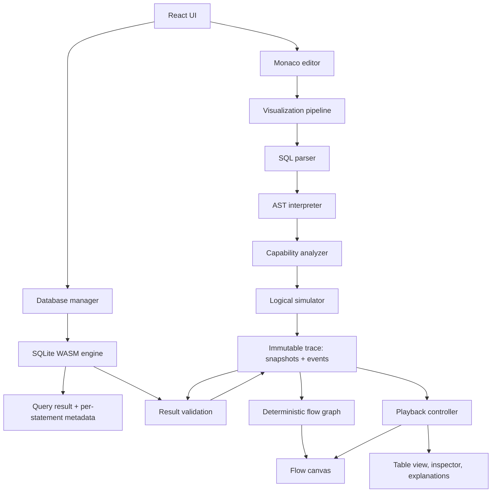

# Architecture

SQL Visualizer is a fully client-side React application. There is no backend, no API and no
telemetry: SQLite is compiled to WebAssembly, while the UI, query history, saved queries and
database files are persisted in the browser's IndexedDB.

The important architectural split is between **real execution** and **visual explanation**:

- SQLite executes every query and produces the authoritative result.
- A separate logical simulator replays supported `SELECT` statements as a sequence of stages,
  then its final output is validated against SQLite.

The two paths share the same SQL text and the same live database, but neither mutates the other.

## Runtime overview



## Real execution path

| Layer | Responsibility | Source |
|:---|:---|:---|
| WASM engine | Load `sql.js`, execute statements, return columns, values, row counts, modified counts and timings. | `src/services/database/sqliteService.ts` |
| Database manager | Own the active SQLite instance, serialize/restore database bytes, and manage per-database lifecycle. | `src/services/database/databaseManager.ts` |
| Database store | Expose open/create/import/export/reset/execute actions to the UI and keep cached metadata in sync. | `src/store/databaseStore.ts` |
| Persistence | Store database metadata, SQLite bytes, active database id, history and saved queries. | `src/services/persistence/persistenceService.ts` |

Execution accepts multiple statements. The normalized result keeps a per-statement breakdown and
mirrors the first result-producing statement for simple consumers. Result rows are never persisted;
history records the SQL text, statement type, timing and row counts.

Database switching is intentionally strict: a visualization trace belongs to the database it was
built from, so switching databases invalidates the trace instead of showing data from the wrong
workspace.

## Visualization path

`visualizationStore.visualize()` orchestrates the pipeline without touching the normal query
execution state:

1. **Parse** the SQL with `node-sql-parser` and confirm it is a single `SELECT`.
2. **Interpret** the AST into a typed query structure. Unsupported constructs are collected as
   explicit reasons, not silently ignored.
3. **Analyze capability** to derive the stages that will run, the constructs in use, warnings and
   an estimated visualization cost.
4. **Simulate** the logical pipeline against live table data, producing immutable stage snapshots
   and an ordered event trace.
5. **Execute for real** and compare the simulator's final columns, row count and values with
   SQLite's result.
6. **Build the flow graph** deterministically from the trace.
7. **Load the trace** into the playback controller, which folds events into the UI view state.

| Stage | Module | What it produces |
|:---|:---|:---|
| Parse | `src/services/sql/sqlParser.ts` | Parser AST and statement classification |
| Interpret | `src/services/visualization/astInterpreter.ts` | `QueryStructure` plus unsupported reasons |
| Analyze | `src/services/visualization/capabilityAnalyzer.ts` | Stages, detected constructs, warnings |
| Simulate | `src/services/visualization/simulator.ts` | Immutable snapshots and event trace |
| Validate | `src/services/visualization/validation.ts` | Parity result against SQLite |
| Layout | `src/services/visualization/graphBuilder.ts` | Nodes, edges, sockets and coordinates |
| Playback | `src/store/visualizationStore.ts` | Folded view state for the current event |
| Render | `src/components/visualization/**` | Canvas, table, inspector and explanations |

### Stage semantics

| Stage | Logical operation |
|:---|:---|
| `FROM` | Load rows from the source table. |
| `JOIN` | Merge rows according to INNER, LEFT or CROSS join semantics. |
| `WHERE` | Evaluate the predicate per row; rejected rows branch off. |
| `GROUP BY` | Collect rows into groups. |
| `HAVING` | Evaluate the group predicate; rejected groups branch off. |
| `SELECT` | Project selected columns and evaluate expressions. |
| `DISTINCT` | Remove duplicate projected rows. |
| `ORDER BY` | Sort rows using the requested keys. |
| `LIMIT` / `OFFSET` | Keep or skip rows at the end of the pipeline. |

Snapshots carry row roles (`accepted`, `filtered`, `duplicated`, `selected`, `skipped`, `grouped`)
so every panel can explain not just what survived, but what was removed and why.

## Simulator guarantees

The simulator is designed to be trustworthy rather than impressive:

- **Live data only.** It reads through an accessor backed by the active SQLite database. Nothing is
  hardcoded or mocked.
- **Read-only.** Simulation never mutates database state.
- **Deterministic.** The same database, query and options produce the same snapshots and events.
- **Stable identities.** Every visualized row has an id that survives filtering, sorting and
  grouping; ids are not derived from array positions.
- **Explicit failure.** Unsupported or unresolvable constructs abort with reasons instead of
  producing a misleading trace.
- **Bounded work.** Visualization is capped at 500 rows and 2,000 events; source previews show up
  to 12 rows. Truncation is reported and never affects real SQLite results.

This is a **logical** execution model, not SQLite's physical query plan. The simulator does not
claim to expose bytecode, indexes or the query planner.

## Validation strategy

Validation compares the trace's final result with SQLite's real result:

- Column labels are compared leniently (case and whitespace insensitive).
- Row counts must match.
- Values must match, with a small relative tolerance for floating-point results.
- Order is compared only when the trace proves a fully determined order (`ORDER BY` without ties).
  Otherwise multiset equality is used, because SQLite does not guarantee row order.

A mismatch is surfaced in the workspace with detail rather than hidden. The real SQLite result is
never altered to make validation pass.

## Playback and synchronization

The trace is immutable. Playback only changes an event index, so seeking backward and forward is
deterministic and cheap. `visualizationStore` folds events up to the current index into a
`VisualizationViewState` (active stage, current snapshot, completed stages, finished flag).

That single view state drives:

- node status and revealed edges on the flow canvas,
- the clause strip and Monaco clause highlight,
- the synchronized table view,
- the node inspector and explanation panel,
- the playback controls.

Both Query and Canvas workspaces stay mounted. Switching views therefore preserves editor
content, results, canvas pan/zoom, selection and playback position.

## Canvas architecture

`graphBuilder` computes a deterministic layout from the trace:

- source tables in a left column, aligned with the operation that consumes them,
- the pipeline spine down the center,
- rejected rows and group nodes fanning out to the right,
- sockets and edge routing computed separately from rendering.

`FlowCanvas` renders HTML nodes and SVG wires, reveals elements only when their data exists, and
keeps interaction (pan, zoom, fit, node selection) independent from the playback state.

## State and persistence

| Zustand store | State |
|:---|:---|
| `databaseStore` | Active database, database list, schema, last result, execution status |
| `editorStore` | SQL text and current clause highlight |
| `historyStore` | Query history and saved named queries |
| `uiStore` | Theme, active workspace view, sidebar and modal state, learning level |
| `visualizationStore` | Trace, playback position, speed, validation and status |

IndexedDB database `sql-visualizer` (version 2) contains:

| Store | Contents |
|:---|:---|
| `databases` | Database metadata records |
| `snapshots` | Serialized SQLite bytes keyed by database id |
| `app` | Small key/value state such as the active database id |
| `history` | Executed query log |
| `queries` | Saved named queries |

Version 1 used a single `database` snapshot. It is kept during upgrade so the legacy workspace can
be migrated into a normal database record without data loss.

## Failure states

The visualization workspace distinguishes:

- `idle` — nothing has been visualized yet,
- `ready` — a trace is loaded and validated,
- `unsupported` — the query cannot be modeled faithfully; reasons are listed,
- `unavailable` — no database or no query is available.

DDL and DML still execute normally; they simply cannot be visualized. This separation keeps the SQL
workspace useful even when the educational model does not apply.

## Source map

```text
src/services/
├─ database/        sql.js wrapper, multi-database manager, seed data, templates
├─ sql/             parser wrapper and SQL formatter
├─ visualization/   interpreter, analyzer, simulator, validation, graph layout, explanations
└─ persistence/     IndexedDB storage and legacy migration

src/components/visualization/
├─ flow/            canvas, node renderers, wires, inspector
├─ VisualizationWorkspace.tsx
├─ PipelinePanel.tsx
├─ TransformationPanel.tsx
├─ ExplanationPanel.tsx
└─ PlaybackControls.tsx
```

## Where to start reading

- **Execution:** `src/services/database/sqliteService.ts` and `src/store/databaseStore.ts`
- **Simulation:** `src/services/visualization/simulator.ts`, starting at `simulateQuery`
- **Validation:** `src/services/visualization/validation.ts`, starting at `simulateAndValidate`
- **Canvas:** `src/services/visualization/graphBuilder.ts` and `src/components/visualization/flow/FlowCanvas.tsx`
- **Playback:** `src/store/visualizationStore.ts`, starting at `foldEvents`

For supported SQL constructs and known gaps, see [FEATURES.md](FEATURES.md). For setup and test
conventions, see [DEVELOPMENT.md](DEVELOPMENT.md).
