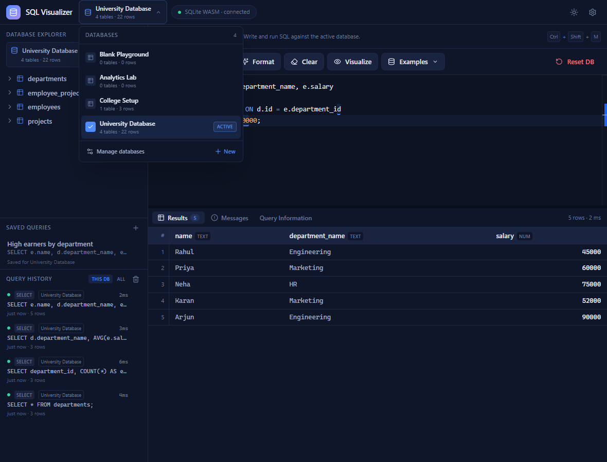

# Feature reference

This document is the detailed inventory of what SQL Visualizer actually does, what it supports only
partially, and what it does not do yet. The [README](../README.md) is the short product tour.

**Legend:** ✅ implemented · ◐ limited, conditional or partial · — not implemented

## Status at a glance

| Area | Status | Summary |
|:---|:---:|:---|
| SQL execution | ✅ | Real SQLite WASM execution, Monaco editor, multi-statement scripts, results, messages and query metadata. |
| Database management | ✅ | Independent databases, templates, custom SQL, import/export, schema explorer and IndexedDB persistence. |
| SQL visualization | ◐ | Logical pipelines for supported SELECT, single-table DML previews and isolated CREATE/ALTER/DROP table/index schema previews; unsupported constructs are reported. |
| Canvas interactions | ✅ | Pan, zoom, node dragging, hover tracing, click-to-pin and branch-aware emphasis. |
| Node Inspector | ✅ | Floating, draggable, resizable, collapsible and minimizable window with real node data and playback sync. |
| Learning and explanations | ◐ | Stage explanations, references and knowledge checks; guided exercises are planned. |
| Validation and errors | ✅ | SQLite result parity, honest validation status and explicit unsupported-query reasons. |

## SQL execution

| Capability | Status | Details |
|:---|:---:|:---|
| Real SQLite execution | ✅ | Queries run in SQLite compiled to WebAssembly (`sql.js`); results are authoritative. |
| Monaco SQL editor | ✅ | SQL syntax highlighting, schema-aware autocomplete and a resizable editor area. |
| Run SQL | ✅ | Executes the editor buffer, including multiple statements separated by semicolons. |
| Keyboard execution | ✅ | `Ctrl/Cmd + Enter` runs the current buffer. |
| Format SQL | ✅ | Formats the current statement with the built-in formatter. |
| Clear editor | ✅ | Clears the buffer without touching the database. |
| Example queries | ✅ | Toolbar menu with ready-made queries for the University example. |
| Visualize | ✅ | Builds a flow trace for supported SELECT, DML and DDL. Mutating previews run only on an isolated copy; normal Run remains writable. |
| Query / Canvas toggle | ✅ | Query is the startup default, including after reload. Both views stay mounted; `Ctrl/Cmd + Shift + M` switches without losing state. |
| Results grid | ✅ | Real SQLite rows with sticky headers and row numbers. |
| Display types | ✅ | Columns are labelled `TEXT`, `NUM` or `BLOB` from the first non-null value. |
| Messages | ✅ | Success and error messages, including the failing statement index. |
| Query information | ✅ | Status, statement types, total time, rows returned, rows modified, query length, referenced tables and the SQLite version. |
| Query history | ✅ | Persists across refreshes, capped at 200 entries; stores SQL and metadata, never result sets. |
| History filtering | ✅ | Filter by the active database or show all databases. |
| Saved queries | ✅ | Named queries persisted in IndexedDB and tagged with the active database when one is open. |
| History maintenance | ✅ | Delete individual entries or clear all history from Settings. |

## Database management

| Capability | Status | Details |
|:---|:---:|:---|
| Multiple databases | ✅ | Independent SQLite files with their own schema. History and saved queries are tagged with their database. |
| Create from template | ✅ | Blank, University example, or custom setup SQL. Only the example template seeds sample data. |
| Open / switch | ✅ | The active database is remembered across reloads. |
| Rename / duplicate | ✅ | Metadata-only rename and a full copy of the database bytes. |
| Reset | ✅ | Replays the setup state for template databases; clears imported databases to empty. |
| Delete | ✅ | Removes database metadata and stored bytes. Existing history and saved queries remain tagged to the deleted database. |
| Export SQLite | ✅ | Downloads the database as a `.sqlite` file. |
| Export SQL | ✅ | Downloads a `.sql` script that recreates the exported database. |
| Import | ✅ | Accepts `.db`, `.sqlite`, `.sqlite3` and `.sql` scripts. Import always creates a new database. |
| Schema explorer | ✅ | Tables, columns, row counts, keys, indexes and original `CREATE TABLE` SQL. |
| Persistent storage | ✅ | Database bytes, metadata, history and saved queries live in IndexedDB. |

  

Switching databases keeps schemas separate; history entries and saved queries stay tagged to the database they came from.

## SQL visualization

| Capability | Status | Details |
|:---|:---:|:---|
| `SELECT` visualization | ✅ | Supported `SELECT` statements and `UNION` / `UNION ALL` / `INTERSECT` / `EXCEPT` compounds can be visualized; unsupported forms execute normally but report reasons. |
| Isolated DML preview | ◐ | Single-table `INSERT`, `UPDATE` and `DELETE` run only on a temporary in-memory copy. The active database, stored snapshot and selection are never changed. |
| Isolated DDL preview | ◐ | Supported table/index DDL runs only on a temporary copy. Real `sqlite_master` and PRAGMA snapshots feed Flow, Table View, inspector and playback. |
| CREATE TABLE preview | ✅ | Explicit column definitions, constraints, generated columns and IF NOT EXISTS no-op handling. CTAS and temporary tables are rejected. |
| ALTER TABLE preview | ✅ | RENAME TO, RENAME COLUMN, ADD COLUMN and DROP COLUMN, with complete row-preservation checks. |
| DROP TABLE preview | ✅ | Removed definition and remaining catalog, including dependent index/trigger removal and IF EXISTS no-ops. Cross-table delete actions are rejected. |
| Index preview | ✅ | Ordinary, UNIQUE, expression and partial CREATE INDEX plus DROP INDEX, with actual PRAGMA metadata and unchanged-row checks. |
| Logical pipeline | ✅ | `FROM`, `JOIN`, `WHERE`, `GROUP BY`, `HAVING`, `SELECT`, `DISTINCT`, `COMPOUND`, `ORDER BY`, `LIMIT` / `OFFSET`; DML and DDL use operation-specific row or schema stages. |
| INSERT preview | ✅ | Single/multiple `VALUES`, supported `INSERT … SELECT`, and `DEFAULT VALUES`, with input rows, target-column mappings, defaults, generated ids and final-table state. |
| UPDATE preview | ✅ | WHERE matching, multiple SET assignments, expression evaluation against original rows, changed/unchanged classification and final-table state. |
| DELETE preview | ✅ | WHERE matching, zero-row and no-WHERE deletes, deleted rows, retained rows and final-table state. |
| Scalar subqueries | ✅ | Non-correlated scalar subqueries in `WHERE`, `SELECT` and `JOIN … ON` are simulated as their own real pipeline; output feeds the consuming stage and is inspectable. |
| Non-recursive CTEs | ✅ | Multiple `WITH` definitions, chained dependencies and explicit column lists. Each CTE is simulated as its own query block with snapshots, events and dependency edges. |
| `IN` / `EXISTS` subqueries | ✅ | Uncorrelated `IN`, `NOT IN`, `EXISTS` and `NOT EXISTS` are simulated as their own blocks with SQLite three-valued logic. `IN` requires a single-column subquery; correlated forms are reported unsupported. |
| `UNION` / `UNION ALL` | ✅ | Every `SELECT` branch is an independent query block with its own snapshots, playback and dependency edges into a shared `COMPOUND` stage. Branches fold left-to-right; `UNION` removes duplicates across the accumulated result (NULLs equal), `UNION ALL` keeps every row. |
| Stage snapshots | ✅ | Immutable snapshots with output rows, removed rows and input/output counts, including filtered and skipped rows. |
| Full-pipeline animation | ✅ | The default playback animates the whole trace from source tables to the final result. |
| Playback | ✅ | Play, pause, previous, next, seek, restart and jump to final result. |
| Speed control | ✅ | 0.5×, 1×, 1.5× and 2×. |
| Flow view | ✅ | Blender-inspired nodes, sockets, animated wires and status colours. |
| Table view | ✅ | Row-level transformation view driven by the same playback position, including query-block stages and the compound result. |
| Clause strip | ✅ | Query clauses are clickable and jump playback to the matching stage. |
| Editor synchronization | ✅ | The active SQL clause is highlighted in Monaco during playback. |
| SQLite validation | ✅ | Compares simulated final columns (using SQLite output names), row count and values with SQLite's real result. |
| Truncation reporting | ✅ | Caps are disclosed; real SQLite output is never truncated. |
| Unsupported-query reporting | ✅ | Lists explicit reasons instead of generating a misleading trace. |

### Supported SQL constructs

- A supported `SELECT` statement with a `FROM` clause, or a `UNION` / `UNION ALL` compound of such
  `SELECT` statements.
- Explicit `INNER JOIN`, `LEFT JOIN` and `CROSS JOIN` with `ON` conditions (except `CROSS JOIN`,
  which needs no condition).
- `WHERE` and `HAVING` predicates using `=`, `!=`, `<>`, `>`, `>=`, `<`, `<=`, `AND`, `OR`, `NOT`,
  `IN`, `BETWEEN`, `IS NULL`, `IS NOT NULL`, `LIKE` and arithmetic (`+`, `-`, `*`, `/`, `%`).
- Column references, table aliases and literals.
- SQLite declared-type affinity during comparisons, including INTEGER/REAL/NUMERIC conversion of
  well-formed numeric text, TEXT conversion of numeric literals, BLOB/no-affinity behavior and SQLite
  storage-class ordering. Conversion applies to comparison operands only and never rewrites stored rows.
- Explicit `COLLATE BINARY` and `COLLATE NOCASE`, plus column-declared forms of those collations, in
  comparisons, `GROUP BY`, `DISTINCT`, aggregate `DISTINCT`, `MIN`/`MAX`, `ORDER BY` and compound set
  operations. NOCASE follows SQLite's ASCII-only case folding.
- Wildcard projections in any position: bare `*`, qualified `table.*`, and mixed lists such as
  `t.*, u.*`, `*, id` or `id, *`. Each wildcard expands only the relation it names (every source
  relation for `*`) in projection order and keeps SQLite's duplicate output column names.
- Output aliases in `WHERE`, `GROUP BY` and `HAVING`, resolved structurally against the aliased
  expression rather than substituted as text.
- `GROUP BY` on supported expressions.
- `COUNT`, `SUM`, `AVG`, `MIN` and `MAX` aggregates.
- `DISTINCT`.
- `ORDER BY` on supported expressions.
- `LIMIT` and `OFFSET` with constant numbers.
- Non-correlated scalar subqueries in `WHERE`, `SELECT` and `JOIN … ON` expressions. Each nested
  block is simulated independently with real snapshots, and its output is shown as an inspectable
  source feeding the consuming stage.
- Non-recursive common table expressions (`WITH`): multiple definitions, chained references and
  explicit column lists. Supported scalar, `IN` and `EXISTS` subqueries may appear inside a CTE body.
- Uncorrelated `IN` / `NOT IN` and `EXISTS` / `NOT EXISTS` subqueries. `IN` / `NOT IN` requires a
  single-column subquery and follows SQLite three-valued logic; `EXISTS` ignores the column count.
- `UNION`, `UNION ALL`, `INTERSECT` and `EXCEPT` compound selects with two or more `SELECT` branches. Each branch is simulated independently and must return the same number of columns (the first branch names the output). Operators fold strictly left-to-right, so `A UNION B INTERSECT C` means `(A UNION B) INTERSECT C`, not `A UNION (B INTERSECT C)`. `UNION` removes duplicates across the accumulated result, `UNION ALL` preserves them until a later distinct operator, `INTERSECT` keeps distinct rows present in both inputs, and `EXCEPT` keeps distinct left rows absent from the right. Complete rows are compared with NULL-safe keys, so corresponding NULLs compare equal. Root `ORDER BY` and `LIMIT` / `OFFSET` apply after the complete chain, and root `WITH` CTEs are evaluated once and are visible to every branch. Each operation records its accumulated left input, next right input, retained rows, excluded rows and duplicates for canvas, playback and inspection. Table View shows the final compound result and first-branch column names.
- Single-table `INSERT INTO … VALUES` (one or many rows), `INSERT INTO … SELECT` using a supported source SELECT, and `INSERT INTO … DEFAULT VALUES`.
- Single-table `UPDATE … SET` with one or more assignments and optional WHERE, and single-table `DELETE FROM` with optional WHERE. DML expressions support literals, arithmetic, comparisons, IN lists, BINARY/NOCASE collation and three-valued NULL logic.
- `CREATE TABLE` with explicit columns and SQLite constraints, including IF NOT EXISTS. `ALTER TABLE` supports RENAME TO, RENAME COLUMN, ADD COLUMN and DROP COLUMN. `DROP TABLE` supports IF EXISTS.
- Ordinary, UNIQUE, expression and partial `CREATE INDEX` on one main-database table, including IF NOT EXISTS, and `DROP INDEX` with optional IF EXISTS. Index expression keys remain explicit nulls in structured metadata rather than fabricated column names.

### DDL schema preview pipeline

- **CREATE TABLE:** starting catalog → stored table definition → PRAGMA columns → constraints/indexes → isolated creation → resulting catalog.
- **ALTER TABLE:** original columns → one ALTER action → transformed columns → resulting catalog. Renames compare every row; ADD/DROP COLUMN compares every surviving column.
- **DROP TABLE:** original definition → isolated drop → removed definition → remaining catalog. Incoming foreign-key delete actions other than NO ACTION are rejected to avoid hidden child-row changes.
- **CREATE INDEX:** starting catalog → index definition → isolated creation → actual PRAGMA index metadata. **DROP INDEX:** existing index → isolated drop → remaining table indexes. Both prove table rows are unchanged.
- Every successful preview executes on a byte-copy clone and reads the post-statement `sqlite_master`, `PRAGMA table_xinfo`, `foreign_key_list`, `index_list` and `index_xinfo` state. IF EXISTS / IF NOT EXISTS no-ops are labelled honestly. The clone always closes; active bytes, IndexedDB snapshots and database selection are untouched.

### DML preview pipeline

- **INSERT:** target table → input rows → target-column mapping → inserted rows → final table.
- **UPDATE:** target table → matched/unmatched rows → assigned values → changed and matched-but-unchanged rows → final table. All SET expressions see the original row, as in SQLite.
- **DELETE:** target table → matched/unmatched rows → deleted rows → retained rows → final table.
- Every successful preview compares independently predicted final rows with the real table captured after sql.js executed on the isolated copy. Constraint errors, missing tables/columns and parity mismatches return no successful trace. A target with more than 500 rows is rejected rather than presenting a capped table as fully validated.

### Limited or conditional behavior

- **Scalar subquery semantics:** an empty subquery result becomes `NULL`, a multi-row result uses the
  first row's first column (SQLite's rule), and a subquery returning more than one column is rejected
  instead of guessed.
- **Correlated subqueries:** qualification-based and schema-resolved correlation are detected before
  execution. Correlated scalar, `IN` and `EXISTS` subqueries are reported as unsupported rather than
  simulated with invented per-row values.
- **CTE scope:** CTEs are non-recursive. A CTE body sees only earlier definitions and cannot reference
  itself; forward and self references are rejected with explicit reasons. `WITH RECURSIVE` is
  reported unsupported.
- **`IN` / `NOT IN` subqueries:** must return exactly one column. `NOT IN` respects SQLite's
  three-valued logic — a `NULL` member makes a non-match unknown, and an empty result is true — so it
  is not treated as a plain inverse of `IN`.
- **Large inputs:** SELECT visualization is capped at 500 rows and 2,000 events. Source previews show at
  most 12 rows. This affects the animation only, never SQLite's result. DML previews reject targets over
  500 rows so final-table parity never covers only a truncated subset.
- **Implicit aggregation:** aggregate queries without `GROUP BY` are simulated as a single group, with
  an explicit warning about SQLite's arbitrary-row behavior for bare columns.
- **Alias precedence:** when an output alias has the same name as a source column, SQLite prefers the
  source column in `WHERE`, `GROUP BY` and `HAVING`; the simulator follows that rule. Duplicate aliases
  resolve to the first matching select item, and a qualified reference such as `t.salary` never resolves
  to an output alias.
- **Wildcard scope:** a wildcard qualifier that does not match a table or alias in the current query
  block (`SELECT z.* FROM employees`) is rejected before simulation with an explicit reason. As in
  SQLite, a table's original name is not accepted once the table is aliased
  (`SELECT employees.* FROM employees e` is rejected; use `e.*`).
- **Collation support:** BINARY and NOCASE are reproduced, including SQLite's explicit-left,
  explicit-right, declared-left, declared-right precedence. NOCASE folds ASCII only; it is not Unicode
  case folding. Other explicit collations are rejected during interpretation. A column declared with
  another collation (for example RTRIM) is rejected only when an operation needs that collation;
  explicitly applying BINARY or NOCASE overrides the declaration.
- **Numeric range:** values use JavaScript numbers, as returned by the existing sql.js interface.
  Comparisons outside its exact 64-bit integer range are not a substitute for SQLite's full integer
  precision. Comparison affinity never changes the stored value or its collision-safe row id.
- **Order validation:** row order is compared strictly only when `ORDER BY` fully determines it;
  otherwise the comparison is order-insensitive.
- **Group nodes:** the canvas renders up to 8 group nodes, with an explicit overflow node when a
  stage produces more. The underlying trace still contains every group.
- **Compound selects:** all four operators are visualized as a left-to-right sequence of actual operation nodes. `INTERSECT` and `EXCEPT` use the splitter fallback when the parser cannot handle a compound form. Branches must return matching column counts, and any capped or incomplete branch or operation marks the compound result incomplete instead of claiming SQLite parity. `INTERSECT ALL`, `EXCEPT ALL`, `UNION DISTINCT` and `INTERSECT DISTINCT` are rejected explicitly.

### Not visualizable yet

These still run in SQLite and return normal results:

- Unsupported DDL (temporary tables, `CREATE TABLE AS SELECT`, views, triggers, schema-qualified objects and batches), `PRAGMA`, transaction control, `ATTACH` / `DETACH` and multiple statements. Supported DDL is previewed only on a clone; unsupported forms still run normally through Run.
- `REPLACE`, `INSERT OR …`, `ON CONFLICT` / UPSERT, `RETURNING`, DML `ORDER BY` / `LIMIT`, joined or
  aliased DML targets, DML subqueries/functions outside the supported row-expression subset, triggers,
  foreign-key CASCADE/SET NULL/SET DEFAULT actions, generated-column targets, `WITHOUT ROWID` targets,
  and updates that change an INTEGER PRIMARY KEY / rowid. These limitations reject the preview instead
  of hiding side effects or changing stable row identity.
- Queries without a `FROM` clause (for example `SELECT 1`).
- Recursive CTEs (`WITH RECURSIVE`).
- Nested compound forms not covered by the existing nested-block interpreter. In particular, `INTERSECT` and `EXCEPT` inside subqueries or CTE bodies are not visualized by the compound fallback.
- Correlated subqueries, including correlated `IN` / `NOT IN` and `EXISTS` / `NOT EXISTS`.
- Derived tables in `FROM` / `JOIN` (`FROM (SELECT …)`), including comma-separated cross joins
  (`FROM a, b`).
- `RIGHT JOIN` and `FULL OUTER JOIN`.
- Window functions and expressions outside the supported grammar, including `CASE`.
- Non-constant `LIMIT` / `OFFSET`.

When a query falls into this list, the app keeps the real SQLite result available and explains why
the visualization is unavailable.

## Canvas interactions

| Capability | Status | Details |
|:---|:---:|:---|
| Pan | ✅ | Drag empty canvas space. |
| Zoom | ✅ | Scroll to zoom around the pointer, with dedicated zoom controls. |
| Fit / reset | ✅ | Fit the whole graph to the viewport or reset the camera. |
| Node dragging | ✅ | Drag nodes to reposition them; nearby nodes settle without changing the query or selection. |
| Hover tracing | ✅ | Hovering a node temporarily emphasizes its branch-aware upstream path. |
| Click tracing | ✅ | Clicking pins the upstream trace and opens the inspector. |
| Branch visibility | ✅ | Rejected rows fan out from filters, `HAVING` and `LIMIT`, duplicates fan out from `DISTINCT`, `UNION`, `INTERSECT` and `EXCEPT`, and group nodes fan out from grouping. |
| Compound wiring | ✅ | Each compound operation has deterministic nodes and branch connections. The first operation consumes the first two branches; later operations consume the previous operation and their next branch, so upstream tracing follows the actual left-to-right sequence. |
| Playback synchronization | ✅ | Node status, revealed wires and branch emphasis follow the current playback event. |
| Selection independence | ✅ | Pan, zoom and node dragging do not change the selected node or playback position. |

## Node Inspector

| Capability | Status | Details |
|:---|:---:|:---|
| Floating popup | ✅ | Opens over the canvas when a node is clicked; reuses the same window when another node is selected. |
| Real node data | ✅ | Uses the immutable trace and live snapshot data through `inspectNode`. |
| Tabs | ✅ | Overview, Input, Output and Details. |
| Node-specific information | ✅ | Operation, clause, input/output counts, group keys, join details, accepted/rejected statistics, nested-subquery inputs, and each compound operation's accumulated left input, next right input, retained rows, excluded rows and duplicates. |
| Row previews | ✅ | Source, intermediate, branch, group and final-result rows where available; paginated for large snapshots. |
| Dragging | ✅ | The persistent header drags the window in expanded and collapsed modes. Header buttons never start a drag. |
| Resizing | ✅ | Eight resize handles in expanded mode; the opposite edge stays anchored and minimum sizes are enforced. |
| Collapse | ✅ | Collapses to the real 52px header height. Content and resize handles are removed from the layout, so there is no invisible expanded area. |
| Collapsed dragging | ✅ | Uses the current header box for movement and workspace clamping; the saved expanded height is preserved separately. |
| Expand | ✅ | Restores the saved width, height, position and active tab. |
| Minimize / restore | ✅ | Minimizing leaves a dock chip that restores the same window; closing dismisses it. |
| Workspace clamping | ✅ | The window stays inside the measured canvas layer on resize; collapsed mode clamps the header box, not the saved expanded height. |
| Playback synchronization | ✅ | The inspector reflects the selected node's current status and never reveals final rows before playback produces them. |
| Focus and controls | ✅ | Header controls remain keyboard-accessible; pointer capture handles pointer-up and pointer-cancel. |

## Learning and explanations

| Capability | Status | Details |
|:---|:---:|:---|
| Documentation sidebar | ✅ | Independently toggleable; open/close releases or reclaims canvas width. |
| Edge tab | ✅ | A compact edge tab reopens the sidebar when it is closed. |
| Narrow layouts | ✅ | The sidebar overlays the canvas instead of squeezing it. |
| Preserved state | ✅ | Scroll position, selected learning level and knowledge-check answer survive closing and reopening. |
| Learning levels | ✅ | Beginner, Intermediate and Advanced explanations. |
| Stage explanations | ✅ | Concept, why the stage matters, what actually happened with real counts, and the snapshot's detailed explanation. |
| Knowledge checks | ◐ | Multiple-choice checks for selected stages at beginner and intermediate levels. Advanced has no check. |
| Documentation links | ✅ | Curated SQLite documentation links per stage. |
| Node explanation switch | ✅ | Selecting a node shows its inspector; the sidebar follows the active or inspected stage. |
| Guided exercises | — | Not implemented. The knowledge checks are the current interactive learning feature. |

## Validation and error handling

| Capability | Status | Details |
|:---|:---:|:---|
| Result parity | ✅ | Compares the simulator's final columns, row count and values with SQLite's real result. |
| Ordered comparison | ✅ | Used when `ORDER BY` proves a fully determined order. |
| Unordered comparison | ✅ | Multiset equality when SQLite does not guarantee row order. |
| Nested block parity | ✅ | Scalar, `IN` / `EXISTS`, CTE and compound-branch blocks are validated independently against SQLite, and the final compound result is validated as a whole. Intermediate operation snapshots are inspection data, not separate parity claims. |
| Numeric tolerance | ✅ | Small relative tolerance for floating-point results. |
| Column checks | ✅ | Lenient label comparison (case and whitespace insensitive) and explicit mismatch details. |
| Validation display | ✅ | The workspace shows validated ordered/unordered status or the mismatch; SQLite output is never altered. |
| Unsupported reasons | ✅ | Unsupported constructs produce explicit, human-readable reasons. |
| Parser failures | ✅ | A statement that cannot be parsed is reported as unavailable for visualization, never approximated. |
| Execution errors | ✅ | SQLite errors appear in the Messages tab with the failing statement. |
| Caps | ✅ | Truncation of the visual trace is disclosed; real results remain complete. Incomplete or capped branches and operations are never presented as fully validated. |

The visualization workspace distinguishes `idle`, `ready`, `unsupported` and `unavailable` states. Unsupported statements still execute normally through Run; supported DML and DDL previews never mutate the active database.

## Personalization and settings

| Capability | Status | Details |
|:---|:---:|:---|
| Dark and light themes | ✅ | Theme is persisted in `localStorage`. |
| Workspace preference | ✅ | Query is the startup default, including after reload. The Query/Canvas choice is session-only and is not restored from an old persisted Canvas selection. |
| Reset active database | ✅ | Available from Settings and the editor toolbar. |
| Clear history | ✅ | Confirmation-protected action in Settings. |
| Engine information | ✅ | Displays the SQLite library version reported by the running engine. |
| Main sidebar | ✅ | Static on desktop and an overlay drawer below the `md` breakpoint. |

## Known limitations

- **Client-only by design.** There is no account system, cloud sync or server-side database. Data
  lives in the current browser profile.
- **Storage is browser-managed.** Clearing site data removes databases, history and saved queries.
  Private browsing modes may reject IndexedDB writes.
- **Single user.** Concurrent editing from multiple tabs is not coordinated.
- **No sharing or export of traces.** The canvas can be inspected and recorded manually, but there is
  no built-in share link or image/video export.
- **No hosted demo.** Run the project locally with `npm run dev`.
- **No guided exercises.** Stage explanations and knowledge checks exist; a full exercise flow does
  not.
- **Educational model, not a query planner.** The simulator models logical stages only; it does not
  claim to expose SQLite's physical plan, indexes or bytecode.

## Related documentation

- [Architecture](ARCHITECTURE.md) — how execution, simulation, validation, playback and inspector geometry fit together.
- [Development guide](DEVELOPMENT.md) — setup, tests and change conventions.
- [README](../README.md) — product overview and screenshots.
